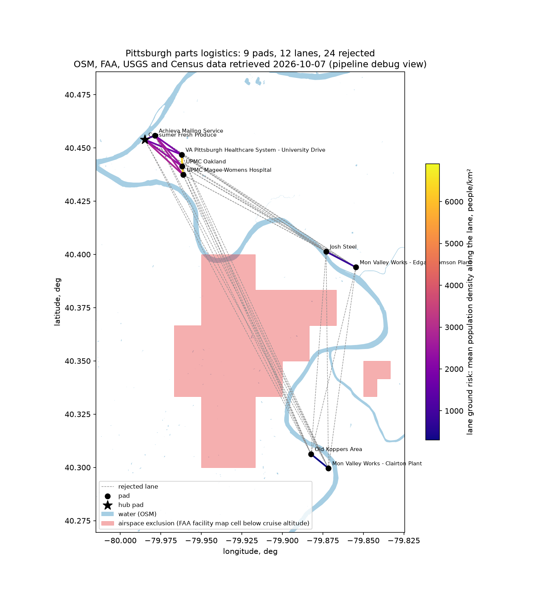

# Results

## Phase 2: synthetic networks

Conditions: commit `4d81103` (numbers re-checked unchanged after the f32 storage change), release build, seed 42, replication 0, each scenario's own
`configs/<name>/scenario.toml`. Every input number is a placeholder (`assumption = true`), so
these numbers show how the model behaves, not what a real network would do. Times are
door-to-door from the shipment request; the truck serves the same orders over the
synthetic road matrix (straight line x 1.4 at 11 m/s, slowed by the time-of-day factors).

| Scenario | Pads | Drones | Window | Deliveries/h | Drone mean / p95 (s) | Truck mean / p95 (s) | Speedup | Drone cost/delivery (cu) | Truck cost/delivery (cu) | Break-even (deliveries per drone-h) | Actual (per drone-h) | Abort rate | Stockout |
|---|---|---|---|---|---|---|---|---|---|---|---|---|---|
| ab_synthetic | 2 | 2 | 7.5 h | 5.5 | 3738 / 9620 | 2462 / 2680 | 0.66 | 2.66 | 25.47 | 0.28 | 2.73 | 0.026 | 0.34 |
| hub_spoke_6 | 6 | 8 | 7.5 h | 14.9 | 2892 / 7200 | 2327 / 2990 | 0.80 | 3.89 | 22.90 | 0.31 | 1.87 | 0.069 | 0.24 |
| mesh_small | 8 | 8 | 7.5 h | 16.0 | 693 / 1080 | 1870 / 2210 | 2.70 | 3.62 | 14.25 | 0.51 | 2.00 | 0.016 | 0.016 |
| scale_200 | 40 | 200 | 167 h | 70.4 | 752 / 1340 | 2042 / 2520 | 2.72 | 20.49 | 17.71 | 0.41 | 0.35 | 0.078 | 0.014 |

Speedup is mean truck time over mean drone time. Break-even is the drone utilisation at
which the drone's cost per delivery equals the truck's (spec 7, M8); above it the drone is
cheaper.

What the numbers say:

- Where pods are plentiful (mesh, scale) the drone is about 2.7 times faster than the truck,
  door to door. Where they are not (A-B, hub-and-spoke) it is slower on average, because
  shippers wait for an empty pod: 34% and 24% of requests found none.
- A-B is pod-starved by design of the example: demand runs 4/h one way and 3/h back with three
  pods per pad and a rebalancing floor of one pod.
- The hub-and-spoke starves the spokes. Spokes send most pods to the hub (`hub_weight` 3), and
  returns have to queue through the hub's single OUT spot behind its own shipments. One OUT
  spot per pad caps a pad at roughly 4.5 launches an hour with these timings (placement,
  pickup flight, latch, charge dwell on OUT); a hub hits that first.
- The scale fleet is cheaper per delivery than the truck only above 0.41 deliveries per
  drone-hour; at 2 requests per pad-hour 200 drones manage 0.35, so the truck wins on cost
  while the drone wins on time. Fewer drones or more demand would cross over.
- Raising `policy.pod_min_per_pad` from 1 to 2 on the scale case cut stockouts from 13% to 1.4%
  and the mean door-to-door from 4237 s to 752 s. Pod circulation, not drone count, was the
  limit.

### Performance

Scale case (200 drones, 40 pads, 7 simulated days), same commit, on an Intel i9-13900K
under WSL2, measured with `/usr/bin/time -v` by `scripts/verify.sh`:

| Measure | Value | Budget (spec A39) |
|---|---|---|
| Events processed | 1 428 035 | |
| Wall time | 0.69 s | 60 s |
| Peak RSS | 8 MB | 200 MB |
| `events.bin` on disk | 112 MB | streamed, never held in memory |
| Heap allocations during one simulated day of the same case | 137 for 207 476 events | no per-event allocation (`sim/tests/allocations.rs`) |

At the overloaded demand the scale case was first written with (6 requests per pad-hour), the
same run processed 2.37 million events in 1.1 s at 10 MB.

## Phase 3: Pittsburgh parts logistics

Conditions: commit `1eec183`, release build, seed 42, replication 0,
`configs/parts_logistics_pittsburgh/scenario.toml`, with the network from the pipeline
(`docs/pipeline.md`; data retrieved 2026-10-07). Seven simulated days; the metrics window starts
after one hour.

Setup: 9 pads, 24 lanes, 8 drones, 16 pods owned by the two warehouses, and 8 shipment requests
per hour. All placeholders.

Times are door to door in seconds, means over shipments delivered to their destination. The drone
time is split into four parts (spec 7, M2) that add up exactly:

- Pod wait: request until the pod is on OUT.
- Queue: pod on OUT until a drone starts latching it, plus time holding over the destination.
- Pad service: latch, charging before take-off, take-off, approaches and release.
- Flight: lanes flown with the pod.

| Destination | Orders | Drone | Pod wait | Queue | Pad service | Flight | Truck |
|---|---|---|---|---|---|---|---|
| VA Pittsburgh Healthcare (Oakland) | 238 | 1010 | 509 | 122 | 251 | 128 | 1945 |
| UPMC Oakland | 239 | 1030 | 516 | 110 | 250 | 153 | 1897 |
| UPMC Magee-Womens (Oakland) | 221 | 1091 | 534 | 126 | 256 | 176 | 1996 |
| Josh Steel (Braddock) | 239 | 1604 | 507 | 116 | 248 | 734 | 2675 |
| Edgar Thomson plant (Braddock) | 216 | 1724 | 512 | 119 | 243 | 850 | 2829 |
| All | 1153 | 1287 | 515 | 118 | 250 | 403 | 2263 |

| Measure | 1x demand | 3x demand |
|---|---|---|
| Requests in window | 1373 | 4030 |
| Rejected at the backlog cap (20 per pad) | 187 (13.6%) | 2510 (62%) |
| Deliveries per hour | 6.90 | 8.82 |
| Drone door to door, mean / p95 (s) | 1287 / 2820 | 13094 / over 14400 |
| Truck door to door, mean / p95 (s) | 2263 / 3040 | 2288 / 3160 |
| Speedup (mean truck / mean drone) | 1.76 | 0.17 |
| Pod wait, mean (s) | 515 | 12262 |
| Stockout fraction | 0.003 | 0.26 |
| Drone / truck cost per delivery (cu) | 8.39 / 23.50 | 6.58 / 24.04 |
| Events, wall time, peak RSS | 240 095, 0.02 s, 5 MB | 286 944, 0.03 s, 5.5 MB |

What the numbers say:

- At the anchor demand the drone beats the truck by about 1000 s on every destination. The
  margin is narrower for the Mon Valley plants, where lanes run 9 to 13 km.
- The biggest part of the drone's time is not flying. It is the 8 to 9 minutes before the pod is
  on OUT: placement plus waiting for OUT to clear of drones that are charging. Pad service adds
  about 4 minutes and the queue about 2. Flight is only 2 to 3 minutes to Oakland and 12 to 14
  to the Mon Valley.
- Clairton gets no deliveries. The only lanes that avoid the airspace exclusion around the AGC
  runways go through the Edgar Thomson plant. That 23 km route needs more energy than the R16
  guard allows with a 5 kg pod, so the pipeline leaves those flows out (logged in
  `derived/report.json`). The truck would serve them; the drone cannot, under these
  placeholders.
- The 187 rejections at 1x all come from one event. On day 4.9 a release fault grounded a drone
  on the Achieva warehouse's IN spot, and spec A18 closes a pad for the rest of the run. From
  then on that warehouse could not place pods, so its requests filled the 20-slot backlog and
  were turned away.

  Without the cap that backlog grew without limit. So did both warehouses' backlogs at 3x
  demand, with 2560 requests still waiting at the end of the week, which is why
  `demand.max_backlog_per_pad` exists (spec P08, M9).
- At 3x the network delivers 8.8 per hour, its ceiling with one OUT spot per warehouse. Accepted
  requests wait over 3 hours for a pod. The backlog stays bounded, and memory stays at 5.5 MB.
- Cost: 8 drones at 0.86 deliveries per drone-hour cost 8.39 cu per delivery against the truck's
  23.50. The placeholder break-even is 0.31 deliveries per drone-hour.

Reproduce: `pipeline/run.sh` (optional; the derived files are committed), then
`sim/target/release/sim run configs/parts_logistics_pittsburgh/scenario.toml --seed 42 --out <dir>`.
For the 3x case, `python3 scripts/scale_demand.py configs/parts_logistics_pittsburgh/scenario.toml 3 <dir>`
writes the scaled copy. `scripts/verify.sh` runs both against the time and memory budget.
