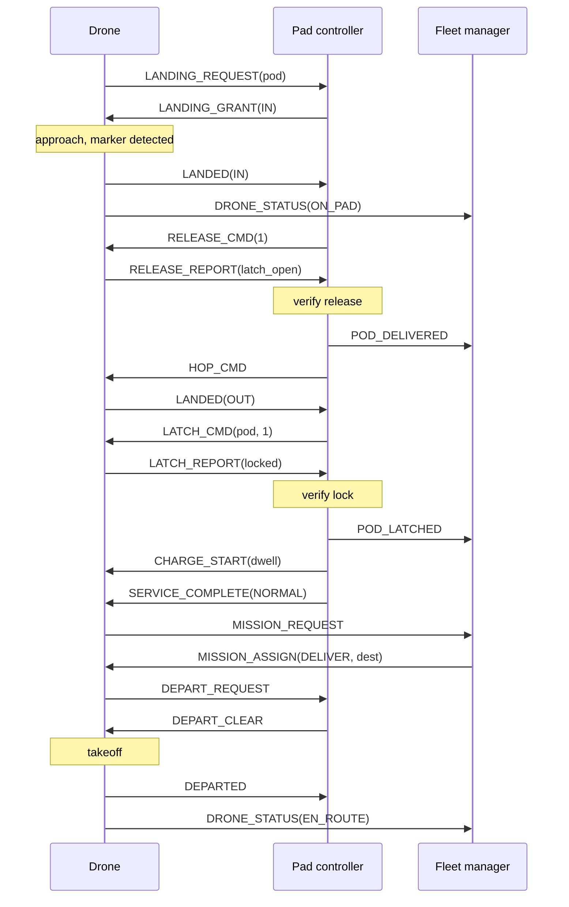

# drone-delivery specification, phase 1 (interface freeze)

Spec version 1.6.0. This document, `schemas/` and `configs/` are the contract for the Rust
discrete-event core, the Python offline pipeline and the PX4/ROS 2 calibration harness.
Version 1.0.0 was frozen in phase 1; every change since then is listed in section 11.

Machine-readable sources of truth:

- `schemas/common.schema.json`: ID types, enums, unit-tagged quantities.
- `schemas/entities.schema.json`: entity records (section 2).
- `schemas/events.schema.json`: DES events and messages (sections 4 and 5).
- `schemas/config.schema.json`: scenario config (section 8).

`scripts/check_spec.py` cross-checks this document against those files. If they disagree, the
schema wins and the disagreement is a bug.

## 0 Conventions

- Units are SI inside the sim. Config values carry their unit explicitly and are converted once,
  at load. Exceptions at the boundary only: `deg` for geodetic coordinates and `1/h` for demand
  rates.
- Sim time is an unsigned integer count of milliseconds since run start (`u64`, field suffix
  `_t_ms`). Durations from config (seconds, f64) convert as `ms = floor(s * 1000 + 0.5)`. All
  timing uses this monotonic sim clock. Wall-clock time never enters the sim.
- Time of day (truck baseline only): `tod_s = (sim.start_time_of_day_s + t_ms / 1000) mod 86400`.
- Positions are local ENU metres (x east, y north) from `geo.origin_lat_deg` and `geo.origin_lon_deg` using an
  equirectangular projection with R = 6 371 000 m. Altitude is not modelled. No quaternions
  appear in any phase-1 interface.
- IDs are dense indices into flat arrays. Pads, drones and pods are numbered in config order;
  orders in creation order. Each ID type reserves its all-ones value as NONE.

  | ID | Width | NONE |
  |---|---|---|
  | `pad_id` | u16 | 65535 |
  | `drone_id` | u16 | 65535 |
  | `pod_id` | u32 | 4294967295 |
  | `order_id` | u32 | 4294967295 |
  | `lane_id` | u32 | 4294967295 |
  | `t_ms` | u64 | 18446744073709551615 (unset) |

- Enum values are UPPER_SNAKE strings in config and JSON, and `u8` codes in memory and binary
  files. The code is the zero-based position in the enum list in `common.schema.json`. Appending
  is a minor version change; reordering or removal is a major one.
- `f32` is used for per-entity physical values (mass, energy, SoC, lengths). Run-long
  accumulators (`energy_charged_j`, metric integrals) are `f64`.
- Abbreviations: PC = pad controller, D = drone agent, FM = fleet manager, DG = demand
  generator, FI = fault injector, OPS = remote operations alert sink, SoC = state of charge.

## 1 Glossary and entities

Components (the things that own state and send messages):

| Component | What it is | Owns |
|---|---|---|
| Pad controller (PC) | One per pad. Runs the pad mode machine, the visit machines and the placement queue. Assigns spots. | `PadState`, `Visit` records for its pad |
| Drone agent (D) | One per drone. Flies, does fiducial precision landing, actuates its own latch, reports state. | `DroneState` |
| Fleet manager (FM) | Single central service. Creates orders, assigns drones, decides missions, holds, diversions and pod returns via the section 6 policies. | `Order`, `Pod` |
| Demand generator (DG) | Produces `SHIPMENT_REQUEST` events from `demand.flows[].rate_per_h`. Stands in for shippers; no person is modelled. | demand RNG streams |
| Fault injector (FI) | Produces `FAULT_START`/`FAULT_END` from `faults[]` and from `pad_ops.pc_fault_rate_per_h`. | fault RNG streams |
| Remote ops (OPS) | Alert sink only. Receives `Alert` records, takes no action in the sim. | `alerts.jsonl` |
| Truck baseline (TB) | Pure function evaluated by FM at order creation. | nothing persistent |
| Offline pipeline | Python (`pipeline/`). Builds a scenario's pad catalog, `lanes.csr.bin` and `truck_matrix.bin` from public map data before a run. | derived files |

Entities:

| Entity | Definition | Record owner (single writer) | Readers |
|---|---|---|---|
| Order | One request to move one pod from an origin pad to a destination pad. Created by FM when it receives `POD_PLACED`. Kind `SHIPMENT` (loaded pod from demand) or `POD_RETURN` (empty pod moved by pod rebalancing). | FM | metrics, D (via mission) |
| Pod | A physical container. Fixed population per run (`pads[].initial_empty_pods`). Circulates between pads; never created or destroyed. | FM (custody updates arrive as PC messages) | PC (inventory mirror) |
| Pad | A landing site with exactly two passive spots, IN and OUT, a parking area of `pads[].parking_capacity` slots (may be 0), a PC, an empty-pod inventory and a return policy. Static data from config; dynamic data in `PadState`. | PC | FM (mirror via `PAD_STATUS`) |
| Spot | IN or OUT at one pad. Holds at most one drone and at most one pod. Has a presence sensor (drone present / pod present, no identity). OUT has charging contacts when the pad has a charger. The parking area (`Spot` value PARKING) holds idle drones only, never pods, and never blocks IN or OUT. | PC | FM |
| Visit | One drone's pass through one pad, from landing request to departure. The unit of the pad state machine (section 3). | PC | metrics |
| Drone | One aircraft with its own latch. Identical class across the fleet. | D | FM (mirror via `DRONE_STATUS`), PC (via handshake) |
| Lane | A directed straight-line air corridor between two pads. Config lists undirected lanes; each becomes two directed lanes in the CSR file. | offline pipeline (static) | D, FM |
| Truck | Baseline only: one dedicated truck per order over the road matrix (time and distance) with time-of-day speed factors. Not simulated as a vehicle. | TB | metrics |

## 2 Schemas

Type column: in-memory type, then the enum name for enum fields. Unit `-` means none.
The flight model signature is in 2.7.

### 2.1 Order

| Field | Type | Unit | Description |
|---|---|---|---|
| order_id | u32 | - | Creation index. |
| kind | u8 OrderKind | - | `SHIPMENT` or `POD_RETURN`. |
| status | u8 OrderStatus | - | Lifecycle, see below. |
| pod_id | u32 | - | Pod carrying this order. |
| origin_pad | u16 | - | Pad where the pod was placed on OUT. |
| dest_pad | u16 | - | Requested destination. |
| delivered_pad | u16 | - | Pad where the pod was actually released. NONE until delivered. Differs from `dest_pad` after a diversion. |
| drone_id | u16 | - | Assigned drone, NONE when unassigned. |
| payload_kg | f32 | kg | Gross pod mass carried (`payload.pod_gross_mass_kg` or `payload.pod_empty_mass_kg`). |
| requested_t_ms | u64 | ms | `SHIPMENT_REQUEST` time (SHIPMENT) or `POD_RETURN_REQUEST` receipt time (POD_RETURN). |
| placed_t_ms | u64 | ms | `POD_PLACE_DONE` time at origin. |
| deadline_t_ms | u64 | ms | `requested_t_ms + demand.deadline_offset_s`; NONE for POD_RETURN. Carried for policies; default policies ignore it. |
| assigned_t_ms | u64 | ms | First assignment time. |
| latched_t_ms | u64 | ms | Lock verified at origin (transition V31/V32). |
| departed_t_ms | u64 | ms | Takeoff from origin completed (`DRONE_STATUS` EN_ROUTE send time). |
| delivered_t_ms | u64 | ms | Release verified at `delivered_pad` (transition V18). |
| truck_delivered_t_ms | u64 | ms | Baseline completion time, computed at creation (section 7, M2). |
| fail_reason | u8 AlertCode | - | Why the order FAILED: RELEASE_FAULT (V20) or DRONE_GROUNDED (D14). Meaningful only when status = FAILED. |
| latch_start_t_ms | u64 | ms | Start of the latch that picked the pod up (V08 or V24 into LATCHING). Measurement only, for the M2 split. |
| flight_ms | u64 | ms | Lane time flown with this order's pod latched (sum over `LANE_DONE`). Measurement only. |
| hold_ms | u64 | ms | Time the carrying drone spent in HOLDING with the pod. Measured on the drone, not the PC, whose HELD state can outlast a hold when a cancel is lost. Measurement only. |

Order status: `CREATED` (on `POD_PLACED`) > `ASSIGNED` (drone chosen) > `LATCHED` (`POD_LATCHED`)
> `IN_TRANSIT` (departed) > one of `DELIVERED` (released at `dest_pad`), `DIVERTED` (released at
an alternate pad), `FAILED` (pod stuck on a grounded drone, or lost in a forced landing). A latch
failure returns an `ASSIGNED` order to `CREATED`.

### 2.2 Pod

| Field | Type | Unit | Description |
|---|---|---|---|
| pod_id | u32 | - | Numbered by pad config order, then 0..initial_empty_pods-1. |
| home_pad | u16 | - | Pad that held it at t = 0. Target of `RETURN_HOME`. |
| location | u8 PodLocation | - | `PAD_INVENTORY`, `PAD_OUT`, `PAD_IN`, `ON_DRONE`, `LOST`. |
| pad_id | u16 | - | Pad when location is PAD_*; NONE otherwise. |
| drone_id | u16 | - | Drone when `ON_DRONE`; NONE otherwise. |
| order_id | u32 | - | Current order; NONE when idle in inventory. |
| loaded | bool | - | true while carrying shipment contents (from placement until removal at IN). |
| return_dest_pad | u16 | - | Set when FM reserves this inventory pod for a return; NONE otherwise. |

### 2.3 PadState

| Field | Type | Unit | Description |
|---|---|---|---|
| pad_id | u16 | - | |
| mode | u8 PadMode | - | `ONLINE`, `CONTROLLER_FAULT`, `OUT_OF_SERVICE`. |
| is_hub | bool | - | From config. |
| has_charger | bool | - | true if `charging.mode` = OUT_CONTACTS, or HUB_ONLY and `is_hub`. |
| service_mode | u8 ServiceMode | - | `AUTO` or `MANUAL` (pod swap by a person: longer release/latch). |
| in_drone | u16 | - | Drone physically on IN. |
| in_reserved_by | u16 | - | Drone granted IN and not yet landed. |
| in_pod | u32 | - | Pod sitting on IN (delivered, awaiting removal). |
| out_drone | u16 | - | Drone physically on OUT. |
| out_reserved_by | u16 | - | Drone granted OUT (approach or hop) and not yet landed. |
| out_pod | u32 | - | Pod sitting on OUT (placed, awaiting latch). |
| out_placing | bool | - | A placement is in progress on OUT (`pad_ops.pod_place_s` running). |
| empty_pods | u16 | count | Empty pods in inventory not reserved for a return. |
| backlog_len | u16 | count | Shipment requests waiting for placement. |
| landing_queue_len | u16 | count | Visits in HELD. |
| parked | u16 | count | Drones in the parking area (always 0 when `parking_capacity` = 0; a drone parked on OUT is counted by `out_drone`). |
| mode_since_t_ms | u64 | ms | Last mode change. |

### 2.4 Visit

| Field | Type | Unit | Description |
|---|---|---|---|
| pad_id | u16 | - | |
| drone_id | u16 | - | At most one open visit per drone at a given pad. A pad that was faulted or waiting on a silent drone may still hold a visit for a drone that has gone elsewhere; its sensor checks close it (V36, V41). |
| state | u8 VisitState | - | Section 3.3. |
| spot | u8 Spot | - | Spot granted or occupied. |
| attempt | u8 | count | Current release or latch attempt, starting at 1. |
| gen | u32 | - | Incremented on every state change; stale timers carry an old gen. |
| state_since_t_ms | u64 | ms | Entry time of `state`. |
| outcome | u8 VisitOutcome | - | `OPEN` until CLOSED. |
| arrived_with_pod | u32 | - | Pod latched to the drone at landing, NONE if empty. |
| pickup_pod | u32 | - | Pod on OUT assigned to this drone via `PICKUP_ASSIGNED`, NONE otherwise. |

### 2.5 DroneState

| Field | Type | Unit | Description |
|---|---|---|---|
| drone_id | u16 | - | |
| mode | u8 DroneMode | - | Section 4.4. |
| pad_id | u16 | - | Pad the drone is on or holding over; NONE en route. |
| mission | u8 MissionKind | - | Current mission. |
| dest_pad | u16 | - | Mission destination. |
| lane_id | u32 | - | Lane being flown when EN_ROUTE; NONE otherwise. |
| pod_id | u32 | - | Latched pod, NONE if empty. |
| order_id | u32 | - | Order of the latched pod. |
| pickup_order_id | u32 | - | Order to collect at `dest_pad`, NONE if none. |
| soc | f32 | 1 | Fraction of `drone.battery_capacity_j`. |
| payload_kg | f32 | kg | Mass of latched pod, 0 if empty. |
| go_arounds | u8 | count | Go-arounds in the current approach cycle. |
| hold_cycles | u8 | count | Marker abort cycles at the current destination. |
| energy_charged_j | f64 | J | Run total delivered into the battery (battery-cycle metric). |
| mode_since_t_ms | u64 | ms | Entry time of `mode`; energy for HOLDING is applied on exit. |

### 2.6 Lane

| Field | Type | Unit | Description |
|---|---|---|---|
| lane_id | u32 | - | Index in the CSR edge arrays (sorted by from_pad, then to_pad). |
| from_pad | u16 | - | Implicit in CSR row. |
| to_pad | u16 | - | |
| length_m | f32 | m | Straight-line distance between pad positions: ENU distance for explicit and synthetic networks, the great-circle distance from `lanes.csr.bin` for a pipeline network (A47). |
| reverse_lane_id | u32 | - | The opposite direction of the same config lane. |
| max_terrain_m | f32 | m | Highest terrain elevation (NAVD88) sampled along the lane (A48); 0 when the network does not come from the pipeline. Carried for routing and risk work; the phase-3 core does not use it. |
| ground_risk_per_km2 | f32 | 1/km2 | Mean population density sampled along the lane, 0 over water (A48, A49); 0 when the network does not come from the pipeline. Carried for routing and risk work; the phase-3 core does not use it. |

### 2.7 Flight model

Signature, pure and deterministic:

```
flight(query: FlightModelQuery) -> FlightEstimate
hover_power_w(payload_kg: f32) -> f32   # W, used for takeoff, approach, go-around, hop, hold
```

#### 2.7.1 FlightModelQuery

| Field | Type | Unit | Description |
|---|---|---|---|
| lane_id | u32 | - | Directed lane. |
| payload_kg | f32 | kg | Latched pod gross mass, 0 when empty. |

#### 2.7.2 FlightEstimate

| Field | Type | Unit | Description |
|---|---|---|---|
| time_s | f32 | s | From top of climb at the origin to the holding fix at the destination. |
| energy_j | f32 | J | Battery energy for that segment. |

Phase-1 placeholder implementation (all coefficients are config keys, see A04):

```
m_total_kg     = drone.empty_mass_kg + drone.latch_mass_kg + payload_kg
k              = (m_total_kg / drone.power_ref_mass_kg) ^ 1.5
time_s         = length_m / drone.cruise_speed_mps
energy_j       = drone.cruise_power_ref_w * k * time_s
hover_power_w  = drone.hover_power_ref_w * k
```

A scenario can replace the coefficients and the drone's phase times with a fitted flight
profile (8.7) without changing this signature; Phase 5 fits one to PX4 SITL flights
(`docs/calibration.md`).

The latch mass is always carried, so it reduces both payload margin
(`drone.mtow_kg - drone.empty_mass_kg - drone.latch_mass_kg`) and range. A multi-lane route is
the sum over its lanes. Calibration from `flight_log.bin` (section 9.3) replaces the
coefficients; the signature does not change.

### 2.8 Alert

| Field | Type | Unit | Description |
|---|---|---|---|
| t_ms | u64 | ms | Raise time. |
| code | u8 AlertCode | - | See table in 4.5. |
| severity | u8 AlertSeverity | - | `INFO`, `WARNING`, `CRITICAL`. |
| source_kind | u8 EntityKind | - | `PAD`, `DRONE` or `FLEET_MANAGER`. |
| source_id | u16 | - | pad_id or drone_id of the raiser; 0 for FM. |
| pad_id | u16 | - | Pad involved, NONE if none. |
| drone_id | u16 | - | Drone involved, NONE if none. |
| order_id | u32 | - | Order involved, NONE if none. |

Alerts are written synchronously to OPS (`alerts.jsonl`). They are not DES events and nothing
in the sim reacts to them. In the tables, "`ALERT` X (SEVERITY)" means an Alert record with
code X is written at that step.

### 2.9 FlightLogRecord

| Field | Type | Unit | Description |
|---|---|---|---|
| t_start_ms | u64 | ms | Lane entry. |
| t_end_ms | u64 | ms | Lane exit (`LANE_DONE`). |
| lane_id | u32 | - | |
| order_id | u32 | - | Order of the latched pod, NONE if empty. |
| payload_kg | f32 | kg | |
| energy_j | f32 | J | Battery energy used on the lane. |
| soc_start | f32 | 1 | |
| soc_end | f32 | 1 | |
| drone_id | u16 | - | |
| from_pad | u16 | - | |
| to_pad | u16 | - | |
| source | u8 FlightSource | - | `DES` or `PX4_SITL`. |

Byte layout in section 9.3.

## 3 Pad state machine

The PC runs three coupled pieces: the pad mode machine (3.1), the placement and removal rules
for pods on the spots (3.2), and one visit machine per drone at the pad (3.3, 3.4). Every
transition below is owned by the PC of that pad unless the Owner column says otherwise.

Spot availability terms used in guards:

- IN is *free* when `in_drone`, `in_reserved_by` and `in_pod` are all NONE.
- OUT is *drone-free* when `out_drone` and `out_reserved_by` are NONE and `out_placing` is false.

### 3.1 Pad mode

| ID | From | To | Owner | Trigger | Guard | Action | Messages |
|---|---|---|---|---|---|---|---|
| M01 | ONLINE | CONTROLLER_FAULT | FI | `FAULT_START` kind PC_FAULT (scheduled in `faults[]`, or random at `pad_ops.pc_fault_rate_per_h`) | mode = ONLINE | PC stops processing. Messages addressed to it are dropped. Every other event addressed to it (its timers, `SHIPMENT_REQUEST`, `POD_PLACE_DONE`, `POD_REMOVE_DONE`) is held and processed at fault end in its original order (A36). State is retained (A17). Random faults schedule `FAULT_END` after `pad_ops.pc_fault_duration_s`. The PC records the fault's end time; a `FAULT_END` at any other time is ignored (A37). | Out: none, silence is the fault. Detected by drones as `D_RESPONSE_TIMEOUT`, then reported as `HOLD_REPORT` reason PC_SILENT (in the air) or `ALERT` PC_SILENT (on the ground). |
| M02 | CONTROLLER_FAULT | ONLINE | FI | `FAULT_END` kind PC_FAULT | none | Fire held timers. For each open visit, re-send the last command sent to that drone. Re-run the landing queue (3.5) and placement (P02). | Out: `PAD_STATUS` mode ONLINE to FM; re-sent visit commands to drones. |
| M03 | ONLINE | OUT_OF_SERVICE | FI or PC | `FAULT_START` kind OUT_OF_SERVICE, or V20 (drone grounded on IN) | mode = ONLINE | Every HELD visit goes to CLOSED outcome REFUSED. Visits already granted or on the pad continue to completion. No new grants, no new placements. | Out: `PAD_STATUS` mode OUT_OF_SERVICE to FM; `LANDING_REFUSED` reason OUT_OF_SERVICE to each HELD drone; on V20 also `ALERT` PAD_OUT_OF_SERVICE (CRITICAL). |
| M04 | OUT_OF_SERVICE | ONLINE | FI | `FAULT_END` kind OUT_OF_SERVICE | no grounded drone on a spot | Resume grants and placements. | Out: `PAD_STATUS` mode ONLINE to FM. |
| M05 | OUT_OF_SERVICE | OUT_OF_SERVICE | FI | `FAULT_START` kind PC_FAULT while OUT_OF_SERVICE | mode != ONLINE | Suppressed. The random draw is still consumed (5.4). | Out: none; the suppressed fault is logged in the event trace as a `FAULT_START` with no effect. |
| M06 | OUT_OF_SERVICE | ONLINE | FI | `REPAIR_DONE` (A69) | no scheduled OUT_OF_SERVICE window is open | The pad no longer counts as grounded. The PC drops its record of the repaired drone on IN, which re-registers (V42); the presence sensor keeps IN from being granted until then. Resume grants and placements. | Out: `PAD_STATUS` mode ONLINE to FM. |

Fault windows of different kinds on the same pad must not overlap (rule R10), so no other
combinations exist. In LANDING_REQUEST handling, mode OUT_OF_SERVICE answers `LANDING_REFUSED`
reason OUT_OF_SERVICE (transition V00).

### 3.2 Pods on spots: placement and removal

| ID | Owner | Trigger | Guard | Action | Messages |
|---|---|---|---|---|---|
| P01 | PC | `SHIPMENT_REQUEST` (DG) | backlog shorter than `demand.max_backlog_per_pad`, or no cap | Append `(requested_t_ms, dest_pad, deadline_t_ms)` to the backlog (FIFO). If `empty_pods` = 0 the request counts as a stockout (M6). Try P02. | In: `SHIPMENT_REQUEST`. Out: if OUT is held by a READY drone with no pickup, `SHIPMENT_PENDING` to FM. |
| P02 | PC | Any change to OUT, inventory, backlog, return queue, or mode | mode = ONLINE; OUT drone-free; `out_pod` = NONE; and either backlog non-empty with `empty_pods` > 0, or return queue non-empty | Take the head of the return queue if the backlog is empty, else the backlog head. Shipments use the lowest-id unreserved empty pod; returns use their named pod. Set `out_placing`; schedule `POD_PLACE_DONE` after `pad_ops.pod_place_s`. | Out: `PAD_STATUS` to FM (inventory changed). |
| P03 | PC | `POD_PLACE_DONE` | none | `out_pod` = pod, `out_placing` = false, pod location PAD_OUT. Re-evaluate any WAIT_OUT visit (V21). | Out: `POD_PLACED` to FM. |
| P04 | PC | Drone leaves IN while `in_pod` != NONE (V24 to V26, or V36 from IN) | none | Schedule `POD_REMOVE_DONE` after `pad_ops.pod_remove_s` (recipient takes the pod; not modelled as a person). | In: `LANDED` (spot OUT) or `DEPARTED` (spot IN). |
| P05 | PC | `POD_REMOVE_DONE` | none | `in_pod` = NONE; pod becomes empty, joins inventory (`empty_pods` += 1). Run the landing queue (3.5). | Out: `POD_REMOVED` to FM. |
| P06 | PC | `POD_RETURN_REQUEST` (FM) | pod is in this pad's inventory | Mark pod reserved (`empty_pods` -= 1), append to return queue. Try P02. | In: `POD_RETURN_REQUEST`. Out: `PAD_STATUS` to FM. |
| P07 | PC | `PICKUP_ASSIGNED` (FM) | `out_pod` or the placement in progress is that pod | Record pickup for the drone's visit (or for its next visit if it has none yet). Re-evaluate V21. | In: `PICKUP_ASSIGNED`. |
| P08 | PC | `SHIPMENT_REQUEST` (DG) | backlog holds `demand.max_backlog_per_pad` requests | Reject the request: nothing is queued and no order will exist. Counts in M9, and as a stockout if `empty_pods` = 0 (M6). | In: `SHIPMENT_REQUEST`. |
| P09 | PC | `REPAIR_DONE` (A69) | the repaired drone still carries its pod | The pod comes off the drone into this pad's inventory as an empty pod (`empty_pods` += 1). Its order stays FAILED. | Out: `POD_REMOVED` to FM. |

FM owns the decision to return a pod (6.5). The PC only places what it is told to place.

### 3.3 Visit states

A visit is created by the first `LANDING_REQUEST` from a drone that has no open visit at this
pad, and destroyed after CLOSED is recorded. Drones placed on OUT at t = 0 start with a visit in
READY.

| State | Meaning | Spot held | Timer armed on entry |
|---|---|---|---|
| HELD | In the landing queue; drone holding in the air. | none | none (the drone re-requests every `handshake.hold_retry_s`) |
| APPROACH | Spot reserved, `LANDING_GRANT` sent, drone approaching with fiducial landing. | IN or OUT reserved | `PC_LANDING_TIMEOUT` = T_land_timeout (3.7) |
| RELEASING | `RELEASE_CMD` sent; drone opening its latch on IN. | IN | `PC_RESPONSE_TIMEOUT` = release duration + `handshake.response_timeout_s` |
| VERIFY_RELEASE | PC checks the drone's latch report against the IN pod sensor. | IN | `PC_VERIFY_RELEASE_DONE` = `pad_ops.release_verify_s` |
| WAIT_OUT | On IN, waiting for OUT to become usable (3.4 V21). | IN | `PC_OUT_WAIT_TIMEOUT` = `pad_ops.out_empty_wait_timeout_s` |
| HOPPING | `HOP_CMD` sent; short flight IN to OUT. | IN, OUT reserved | `PC_RESPONSE_TIMEOUT` = `drone.hop_s` + `handshake.response_timeout_s` |
| LATCHING | `LATCH_CMD` sent; drone closing its latch on the OUT pod. | OUT | `PC_RESPONSE_TIMEOUT` = latch duration + `handshake.response_timeout_s` |
| VERIFY_LOCK | PC checks the drone's lock report. | OUT | `PC_VERIFY_LOCK_DONE` = `pad_ops.latch_verify_s` |
| CHARGING | Contacts on OUT energised for the computed dwell. | OUT | `PC_CHARGE_DONE` = dwell (3.7) |
| READY | Service finished; waiting for the drone's `DEPART_REQUEST`. A drone parked on OUT (pad with `parking_capacity` = 0) stays here. A drone leaving the parking area passes through here (V40). | IN, OUT or PARKING | none |
| DEPARTING | `DEPART_CLEAR` sent; drone taking off, or moving into the parking area (mission PARK). | IN, OUT or PARKING | `PC_RESPONSE_TIMEOUT` = (`drone.hop_s` if mission PARK, else `drone.takeoff_s`) + `handshake.response_timeout_s` |
| DRONE_SILENT | Drone stopped answering after retries; spot stays blocked. | as before | none |
| CLOSED | Terminal. `outcome` records why. | none | none |

Release duration is `pad_ops.release_s` (AUTO) or `pad_ops.manual_release_s` (MANUAL); latch
duration is `pad_ops.latch_s` or `pad_ops.manual_latch_s`.

Parking: a drone moves from IN or OUT into the parking area as a departure with mission PARK
(V34, V36) that takes `drone.hop_s`, and leaves it as a normal departure (V40, V34, V36). The
PC counts `parked` on those `DEPARTED` messages. Drones in the parking area hold no spot.

### 3.4 Visit transitions

Retry rule used by every `PC_RESPONSE_TIMEOUT` row: re-send the same command (same attempt
number, idempotent) up to `handshake.max_retries` times, re-arming the timer each time.
Sensor fallback: for `LANDED` and `DEPARTED` only, an expired timer is resolved from the spot
presence sensor instead of declaring silence (A12).

| ID | From | To | Owner | Trigger | Guard | Action | Messages |
|---|---|---|---|---|---|---|---|
| V00 | (none) | CLOSED | PC | `LANDING_REQUEST` | mode = OUT_OF_SERVICE | outcome REFUSED. | In: `LANDING_REQUEST`. Out: `LANDING_REFUSED` reason OUT_OF_SERVICE. |
| V01 | (none) | APPROACH | PC | `LANDING_REQUEST` | mode = ONLINE; landing queue empty; a spot is available (3.5) | Reserve spot; arm `PC_LANDING_TIMEOUT`. | In: `LANDING_REQUEST`. Out: `LANDING_GRANT` (spot). |
| V02 | (none) | HELD | PC | `LANDING_REQUEST` | mode = ONLINE; no spot available or queue non-empty | Append to landing queue. | In: `LANDING_REQUEST`. Out: `LANDING_HOLD` reason IN_OCCUPIED, `queue_pos`. |
| V03 | HELD | HELD | PC | `LANDING_REQUEST` (keep-alive) | still not head with a spot | none | In: `LANDING_REQUEST`. Out: `LANDING_HOLD` with current `queue_pos`. |
| V04 | HELD | APPROACH | PC | Landing queue run (3.5), caused by any spot becoming available | visit is queue head; spot available | Reserve spot; arm `PC_LANDING_TIMEOUT`. | Out: `LANDING_GRANT` (spot). |
| V05 | HELD or APPROACH | CLOSED | PC | `LANDING_CANCEL` | none | Free any reservation; outcome CANCELLED; run landing queue. | In: `LANDING_CANCEL`. |
| V06 | APPROACH | RELEASING | PC | `LANDED` spot IN | `pod_id` != NONE | `in_drone` = d, clear reservation, attempt = 1. | In: `LANDED`. Out: `RELEASE_CMD` attempt 1. |
| V07 | APPROACH | WAIT_OUT | PC | `LANDED` spot IN | `pod_id` = NONE | `in_drone` = d; arm `PC_OUT_WAIT_TIMEOUT`; evaluate V21 immediately. | In: `LANDED`. |
| V08 | APPROACH | LATCHING | PC | `LANDED` spot OUT | `out_pod` = visit `pickup_pod` | `out_drone` = d, attempt = 1. | In: `LANDED`. Out: `LATCH_CMD` attempt 1. |
| V09 | APPROACH | CHARGING | PC | `LANDED` spot OUT | no pickup; `has_charger`; soc < `drone.charge_target_soc` | Compute dwell (3.7). | In: `LANDED`. Out: `CHARGE_START` (dwell_s). |
| V10 | APPROACH | READY | PC | `LANDED` spot OUT | no pickup; no charge needed or no charger | none | In: `LANDED`. Out: `SERVICE_COMPLETE` outcome NO_POD. |
| V11 | APPROACH | APPROACH | PC | `LANDING_REQUEST` from the same drone | none (its grant was lost) | Restart `PC_LANDING_TIMEOUT`: the drone approaches from this grant. | In: `LANDING_REQUEST`. Out: `LANDING_GRANT` re-sent. |
| V12 | APPROACH | CLOSED | PC | `APPROACH_ABORT` reason MARKER_NOT_DETECTED | none | Free reservation; outcome APPROACH_ABORTED; run landing queue. | In: `APPROACH_ABORT`. |
| V13 | APPROACH | per V06 to V10 | PC | `PC_LANDING_TIMEOUT` | granted spot sensor shows a drone | Treat as `LANDED` using the pod/soc from the drone's `LANDING_REQUEST`. | Out: `RELEASE_CMD`, `LATCH_CMD`, `CHARGE_START` or `SERVICE_COMPLETE`, as in the matching row V06 to V10. |
| V14 | APPROACH | CLOSED | PC | `PC_LANDING_TIMEOUT` | granted spot sensor empty | Free reservation; outcome LOST_CONTACT; run landing queue. | Out: `ALERT` DRONE_SILENT (WARNING). |
| V15 | RELEASING | VERIFY_RELEASE | PC | `RELEASE_REPORT` | none | Store `latch_open`; arm verify timer. | In: `RELEASE_REPORT`. |
| V16 | RELEASING | RELEASING | PC | `PC_RESPONSE_TIMEOUT` | retries left | Retry rule. | Out: `RELEASE_CMD` re-sent. |
| V17 | RELEASING, HOPPING, LATCHING, DEPARTING | DRONE_SILENT | PC | `PC_RESPONSE_TIMEOUT` | no retries left; sensor fallback not applicable or sensor shows the drone still on its original spot | Remember the state left; spot stays blocked; arm `PC_RESPONSE_TIMEOUT` every `handshake.response_timeout_s` to watch the spot sensor (V41). | Out: `ALERT` DRONE_SILENT (WARNING). |
| V18 | VERIFY_RELEASE | WAIT_OUT | PC | `PC_VERIFY_RELEASE_DONE` | `latch_open` and IN pod sensor shows a pod | `in_pod` = pod; pod location PAD_IN, `loaded` stays true until removal; arm `PC_OUT_WAIT_TIMEOUT`; evaluate V21. **Delivery measurement point.** | Out: `POD_DELIVERED` to FM. |
| V19 | VERIFY_RELEASE | RELEASING | PC | `PC_VERIFY_RELEASE_DONE` | release not verified; attempt <= `pad_ops.release_max_retries` | attempt += 1. | Out: `RELEASE_CMD` (new attempt). |
| V20 | VERIFY_RELEASE | CLOSED | PC | `PC_VERIFY_RELEASE_DONE` | release not verified; attempt > `pad_ops.release_max_retries` | outcome DRONE_GROUNDED; drone stays on IN with its pod; pad mode goes OUT_OF_SERVICE (M03) until a repair (A69), or for the rest of the run without `pad_ops.repair_mean_s`. With it, schedule `REPAIR_DONE` after one REPAIR draw. | Out: `ALERT` RELEASE_FAULT (CRITICAL); `SERVICE_COMPLETE` outcome RELEASE_FAILED to the drone. |
| V21 | WAIT_OUT | HOPPING | PC | Evaluated on WAIT_OUT entry, on P03, P07, any OUT change, and `PC_OUT_WAIT_TIMEOUT` | OUT drone-free, and either `out_pod` = `pickup_pod`, or `out_pod` = NONE and (`pad_ops.out_empty_policy` = DEPART_EMPTY or the out-wait timer has expired) | Reserve OUT. | Out: `HOP_CMD`. |
| V22 | WAIT_OUT | READY | PC | `PC_OUT_WAIT_TIMEOUT` | V21 guard false (OUT holds another drone or another drone's pod) | Drone will depart from IN without charging. | Out: `SERVICE_COMPLETE` outcome NO_POD, spot IN. |
| V23 | HOPPING | HOPPING | PC | `PC_RESPONSE_TIMEOUT` | OUT sensor empty; retries left | Retry rule. | Out: `HOP_CMD` re-sent. |
| V24 | HOPPING | LATCHING | PC | `LANDED` spot OUT, or `PC_RESPONSE_TIMEOUT` with OUT sensor showing a drone | `out_pod` = `pickup_pod` | `in_drone` = NONE, `out_drone` = d, attempt = 1; P04; run landing queue. | In: `LANDED`. Out: `LATCH_CMD` attempt 1. |
| V25 | HOPPING | CHARGING | PC | as V24 | no pickup; `has_charger`; soc < `drone.charge_target_soc` | as V24 without latch; compute dwell. | In: `LANDED`. Out: `CHARGE_START`. |
| V26 | HOPPING | READY | PC | as V24 | no pickup; no charge needed or no charger | as V24 without latch. | In: `LANDED`. Out: `SERVICE_COMPLETE` outcome NO_POD, spot OUT. |
| V27 | LATCHING | LATCHING | PC | `PC_RESPONSE_TIMEOUT` | retries left | Retry rule. | Out: `LATCH_CMD` re-sent. |
| V28 | LATCHING | VERIFY_LOCK | PC | `LATCH_REPORT` | none | Store `locked`; arm verify timer. | In: `LATCH_REPORT`. |
| V29 | VERIFY_LOCK | LATCHING | PC | `PC_VERIFY_LOCK_DONE` | not locked; attempt <= `pad_ops.latch_max_retries` | attempt += 1. | Out: `LATCH_CMD` (new attempt). |
| V30 | VERIFY_LOCK | CHARGING or READY | PC | `PC_VERIFY_LOCK_DONE` | not locked; attempt > `pad_ops.latch_max_retries` | Pod stays on OUT; pickup cleared. CHARGING if the V25 charge guard holds, else READY. | Out: `ALERT` LATCH_FAULT (WARNING); `CHARGE_START`, or `SERVICE_COMPLETE` outcome LATCH_FAILED. |
| V31 | VERIFY_LOCK | CHARGING | PC | `PC_VERIFY_LOCK_DONE` | locked; charge guard holds | `out_pod` = NONE; pod location ON_DRONE. | Out: `POD_LATCHED` to FM; `CHARGE_START`. |
| V32 | VERIFY_LOCK | READY | PC | `PC_VERIFY_LOCK_DONE` | locked; charge guard false | as V31. | Out: `POD_LATCHED` to FM; `SERVICE_COMPLETE` outcome NORMAL. |
| V33 | CHARGING | READY | PC | `PC_CHARGE_DONE` | none | Add energy to the drone (3.7). | Out: `SERVICE_COMPLETE` with the outcome the visit carries (NORMAL, NO_POD or LATCH_FAILED) and new soc. |
| V34 | READY | DEPARTING | PC | `DEPART_REQUEST` | no other visit at this pad is HOPPING or DEPARTING (one airborne movement at a time, A32) | Arm timer. If the guard is false, hold the request and re-evaluate when that movement ends. | In: `DEPART_REQUEST`. Out: `DEPART_CLEAR`. |
| V35 | DEPARTING | DEPARTING | PC | `PC_RESPONSE_TIMEOUT` | spot sensor still shows the drone; retries left | Retry rule. | Out: `DEPART_CLEAR` re-sent. |
| V36 | DEPARTING | CLOSED | PC | `DEPARTED`, or `PC_RESPONSE_TIMEOUT` with spot sensor empty | none | Free spot (or `parked` -= 1 when leaving PARKING); `parked` += 1 when the mission was PARK; outcome COMPLETED; P04 if leaving IN; run landing queue; P02. | In: `DEPARTED`. |
| V37 | DRONE_SILENT | state left | PC | Any message from that drone | none | Return to the remembered state, re-arm its `PC_RESPONSE_TIMEOUT`, then process the message as in that state. | In: any drone message (`LANDED`, `RELEASE_REPORT`, `LATCH_REPORT`, `DEPART_REQUEST`, `DEPARTED`). Out: as the resumed state's row. |
| V38 | any open state except HELD | same | PC | Duplicate drone message already answered (retry after a lost reply) | none | Idempotent: no state change. | Out: re-send the last command for this visit (for CHARGING: `CHARGE_START` with remaining dwell). |
| V39 | READY | READY | PC | P01 adds to the backlog | visit is on OUT with no pickup (a drone parked on OUT looks like this to the PC) | none; FM decides whether the drone yields (6.4) | Out: `SHIPMENT_PENDING` (pad_id, out_drone) to FM. |
| V40 | (none) | READY | PC | `DEPART_REQUEST` from a drone with no open visit | the parking sensor shows the drone in the parking area | Create a visit at spot PARKING, then apply V34 at once. | In: `DEPART_REQUEST`. Out: `DEPART_CLEAR` (via V34). |
| V41 | DRONE_SILENT | CLOSED | PC | `PC_RESPONSE_TIMEOUT` | the spot sensor shows the spot empty | The silent drone has left. If it was DEPARTING, act as V36 (outcome COMPLETED); otherwise free the spot, outcome LOST_CONTACT. | In: none needed; the trigger is the sensor check on `PC_RESPONSE_TIMEOUT`. |
| V42 | (none) | per V06 to V10 | PC | `LANDED` from a drone with no open visit at this pad (its grant timed out just before touchdown, V14, or it is back in service after a repair, D25) | the spot sensor shows that drone on the spot and the PC holds no other drone or reservation there | Adopt it: create the visit and continue as V06 to V10. | In: `LANDED`. Out: as the matching row V06 to V10 (`RELEASE_CMD`, `LATCH_CMD`, `CHARGE_START` or `SERVICE_COMPLETE`). |

`LANDING_CANCEL` or `APPROACH_ABORT` for a drone with no open visit is ignored; `LANDED` is
handled by V42 and `DEPART_REQUEST` by V40. The visit
gen is incremented on every row, so timers from an earlier state are ignored.

### 3.5 Spot assignment and the landing queue

On `LANDING_REQUEST` from drone d (and on every queue run, for the queue head):

1. d carries a pod: grant IN if IN is free. Otherwise not available.
2. d is empty: grant OUT if OUT is drone-free and `out_pod` is NONE or d's pickup pod.
   Otherwise grant IN if IN is free. Otherwise not available.

Interlock: a spot is available only if its presence sensor also shows no drone on it, whatever
the PC's records say (fail-safe against a stale record).

The landing queue is FIFO by first request time. A queue run happens whenever a spot becomes
available (V05, V12, V14, V24 to V26, V36, P05, M02) and grants at most one visit per spot.

### 3.6 Failure branches

Each listed failure branch, where it lives in the machine, the handshake and the config:

| Branch | Detection (owner) | Pad / visit transitions | Drone / FM side | Handshake messages | Config keys |
|---|---|---|---|---|---|
| Marker not detected: go-around, then hold | D at `APPROACH_DONE` (MARKER stream) | V12 closes the visit after the last go-around | D05, D06, D21; FM holding policy (6.3) | `APPROACH_ABORT`, `HOLD_REPORT` reason MARKER_NOT_DETECTED, `HOLD_CONTINUE` or `MISSION_ASSIGN` DIVERT | `pad_ops.p_marker_detect`, `pad_ops.max_go_arounds`, `drone.go_around_s`, `policy.marker_hold_s`, `policy.marker_max_hold_cycles`, `faults[].kind` MARKER_NOT_DETECTED |
| Pad controller fault: divert to alternate pad | D by `D_RESPONSE_TIMEOUT` after retries | M01, M02 | D10 in the air, D16 on the ground; FM diverts on PC_SILENT | `HOLD_REPORT` reason PC_SILENT, `MISSION_ASSIGN` DIVERT, `ALERT` PC_SILENT | `pad_ops.pc_fault_rate_per_h`, `pad_ops.pc_fault_duration_s`, `handshake.response_timeout_s`, `handshake.max_retries`, `handshake.pc_silence_alert_s`, `faults[].kind` PC_FAULT |
| IN occupied: hold or divert | PC at request (3.5) | V02, V03, V04 | D07; FM hold limit or immediate divert | `LANDING_HOLD`, `HOLD_REPORT` reason IN_OCCUPIED, `HOLD_CONTINUE` or `MISSION_ASSIGN` DIVERT | `policy.in_occupied_action`, `policy.max_hold_s`, `handshake.hold_retry_s` |
| Release fault: retry once, then alert | PC at `PC_VERIFY_RELEASE_DONE` | V19 (retry), V20 (alert, ground, pad out of service), then after a repair P09, M06, V42 | D13 to GROUNDED; FM marks order FAILED; D25 after a repair | `RELEASE_CMD`, `RELEASE_REPORT`, `SERVICE_COMPLETE` RELEASE_FAILED, `ALERT` RELEASE_FAULT | `drone.p_release_fault`, `pad_ops.release_max_retries`, `pad_ops.release_verify_s`, `pad_ops.repair_mean_s`, `pad_ops.repair_spread_s`, `faults[].kind` RELEASE_FAULT |
| OUT empty: wait up to timeout or depart empty | PC in WAIT_OUT | V21 (hop when pod arrives, or empty after timeout / immediately), V22 | FM gives a non-pickup mission | `HOP_CMD`, `SERVICE_COMPLETE` NO_POD | `pad_ops.out_empty_policy`, `pad_ops.out_empty_wait_timeout_s` |
| Latch fail: retry once, then depart empty and alert | PC at `PC_VERIFY_LOCK_DONE` | V29 (retry), V30 (alert, depart empty) | FM re-opens the order (6.1) | `LATCH_CMD`, `LATCH_REPORT`, `SERVICE_COMPLETE` LATCH_FAILED, `ALERT` LATCH_FAULT | `drone.p_latch_fault`, `pad_ops.latch_max_retries`, `pad_ops.latch_verify_s`, `faults[].kind` LATCH_FAULT |
| Pad out of service: reroute inbound | FI or V20 | M03, M04, V00 | FM re-missions every drone whose `dest_pad` is the pad (6.6); D11 if refused at the fix | `PAD_STATUS`, `LANDING_REFUSED`, `HOLD_REPORT` reason OUT_OF_SERVICE, `MISSION_ASSIGN` DIVERT | `faults[].kind` OUT_OF_SERVICE, `faults[].start_s`, `faults[].duration_s` |

### 3.7 Derived durations and energies

These are formulas over config keys, not separate keys.

```
T_cycle_s        = (pad_ops.max_go_arounds + 1) * drone.approach_s + pad_ops.max_go_arounds * drone.go_around_s
T_land_timeout_s = T_cycle_s + handshake.response_timeout_s
charge_dwell_s   = max(0, drone.charge_target_soc - soc) * drone.battery_capacity_j
                   / (charging.power_w * charging.efficiency)
energy_added_j   = charge_dwell_s * charging.power_w * charging.efficiency
```

## 4 Pad-drone handshake

### 4.1 Links, delivery and retries

- Every message is a DES event of class MESSAGE delivered at `sent + latency` (5.1).
  D <-> PC uses `handshake.local_latency_s`; any link touching FM uses `handshake.fm_latency_s`.
- Only the D <-> PC radio link loses messages, each independently with probability
  `handshake.p_msg_loss` (MSG_LOSS stream). FM links are lossless (A20). Messages to a PC in
  CONTROLLER_FAULT are dropped.
- Every message carries `msg_seq` (per sender, +1 per new message, unchanged on re-send) and
  `sent_t_ms`. Receivers treat a repeated `msg_seq` as a duplicate: they do not act twice and
  re-send their last reply (V38, D17).
- Radio messages also carry `link_seq`, which numbers the messages of one direction of one
  D <-> PC link (+1 per new message, unchanged on re-send). With `handshake.reorder_window_s`
  above 0 a receiver processes them in `link_seq` order (A70). A message ahead of a gap is
  held (logged DEFERRED) until the missing one arrives or the window ends (`REORDER_RELEASE`);
  then the gap counts as a lost message. A `link_seq` below the expected one is a re-send or a
  late copy and is processed at once, as a duplicate. `events.bin` records `msg_seq` only.
- The requester owns retries. Request/reply pairs and their timeouts are in 4.2. After
  `handshake.max_retries` re-sends without reply, the requester takes the silence branch (4.5).

### 4.2 Messages

Fields are the payload; the envelope (`msg_seq`, `sent_t_ms`) is common to all.

| Message | From → To | Fields | Expected reply / timeout |
|---|---|---|---|
| LANDING_REQUEST | DRONE → PAD | `drone_id, pad_id, pod_id, soc` | `LANDING_GRANT`, `LANDING_HOLD` or `LANDING_REFUSED` within `handshake.response_timeout_s` |
| LANDING_CANCEL | DRONE → PAD | `drone_id, pad_id` | none |
| APPROACH_ABORT | DRONE → PAD | `drone_id, pad_id, reason` | none |
| LANDED | DRONE → PAD | `drone_id, pad_id, spot, pod_id, soc` | next command; PC side covered by `PC_LANDING_TIMEOUT` and sensor fallback |
| RELEASE_REPORT | DRONE → PAD | `drone_id, pad_id, latch_open` | next command (`HOP_CMD`, `RELEASE_CMD`) or `SERVICE_COMPLETE` |
| LATCH_REPORT | DRONE → PAD | `drone_id, pad_id, pod_id, locked` | `LATCH_CMD`, `CHARGE_START` or `SERVICE_COMPLETE` |
| DEPART_REQUEST | DRONE → PAD | `drone_id, pad_id, dest_pad, mission` | `DEPART_CLEAR` within `handshake.response_timeout_s` (or held by V34 guard; the drone keeps re-sending) |
| DEPARTED | DRONE → PAD | `drone_id, pad_id, spot` | none; PC side covered by sensor fallback |
| LANDING_GRANT | PAD → DRONE | `pad_id, drone_id, spot` | drone answers with `LANDED` or `APPROACH_ABORT` within T_land_timeout_s |
| LANDING_HOLD | PAD → DRONE | `pad_id, drone_id, reason, queue_pos` | none; the drone re-requests every `handshake.hold_retry_s` |
| LANDING_REFUSED | PAD → DRONE | `pad_id, drone_id, reason` | none |
| RELEASE_CMD | PAD → DRONE | `pad_id, drone_id, attempt` | `RELEASE_REPORT` within release duration + `handshake.response_timeout_s` |
| HOP_CMD | PAD → DRONE | `pad_id, drone_id` | `LANDED` spot OUT within `drone.hop_s` + `handshake.response_timeout_s` |
| LATCH_CMD | PAD → DRONE | `pad_id, drone_id, pod_id, attempt` | `LATCH_REPORT` within latch duration + `handshake.response_timeout_s` |
| CHARGE_START | PAD → DRONE | `pad_id, drone_id, dwell_s` | none; the drone expects `SERVICE_COMPLETE` within `dwell_s` + `handshake.response_timeout_s` |
| SERVICE_COMPLETE | PAD → DRONE | `pad_id, drone_id, outcome, spot, pod_id, soc` | none to PC; the drone sends `MISSION_REQUEST` to FM |
| DEPART_CLEAR | PAD → DRONE | `pad_id, drone_id` | `DEPARTED` within `drone.takeoff_s` + `handshake.response_timeout_s` |
| DRONE_STATUS | DRONE → FLEET_MANAGER | `drone_id, mode, pad_id, dest_pad, pod_id, soc` | none. Sent on entering EN_ROUTE, ON_PAD, PARKED, GROUNDED. |
| MISSION_REQUEST | DRONE → FLEET_MANAGER | `drone_id, pad_id, spot, pod_id, soc, outcome` | `MISSION_ASSIGN` (lossless link, no timeout) |
| HOLD_REPORT | DRONE → FLEET_MANAGER | `drone_id, pad_id, reason, hold_cycles, soc` | `HOLD_CONTINUE` or `MISSION_ASSIGN` DIVERT |
| MISSION_ASSIGN | FLEET_MANAGER → DRONE | `drone_id, mission, dest_pad, order_id, pickup_order_id` | the drone sends `DEPART_REQUEST`, or nothing for PARK |
| HOLD_CONTINUE | FLEET_MANAGER → DRONE | `drone_id, pad_id, retry_after_s` | the drone re-requests landing after `retry_after_s` |
| POD_PLACED | PAD → FLEET_MANAGER | `pad_id, pod_id, kind, dest_pad, requested_t_ms, deadline_t_ms, payload_kg` | none; FM creates the order |
| POD_LATCHED | PAD → FLEET_MANAGER | `pad_id, pod_id, drone_id` | none |
| POD_DELIVERED | PAD → FLEET_MANAGER | `pad_id, pod_id, drone_id` | none |
| POD_REMOVED | PAD → FLEET_MANAGER | `pad_id, pod_id` | none |
| PAD_STATUS | PAD → FLEET_MANAGER | `pad_id, mode, empty_pods, backlog_len, in_drone, out_drone, out_pod, marker_fault` | none. Sent on mode change and inventory change, and, with `pad_ops.marker_self_check`, when a marker fault starts or ends (A35). `marker_fault` is false without the self-check. |
| SHIPMENT_PENDING | PAD → FLEET_MANAGER | `pad_id, out_drone` | FM re-missions `out_drone` (6.4) |
| PICKUP_ASSIGNED | FLEET_MANAGER → PAD | `pad_id, pod_id, order_id, drone_id` | none |
| POD_RETURN_REQUEST | FLEET_MANAGER → PAD | `pad_id, pod_id, dest_pad` | none; the PC places the pod when OUT allows (P02) |

### 4.3 Normal visit sequence

Drone arrives with a pod, a pod is waiting on OUT for it, and the drone needs charge.



### 4.4 Drone side

Owner of every row: the drone agent. Energy for a timed activity is applied when it ends:
hover activities use `hover_power_w(payload)` times duration, lanes use the flight model.
Every request with a reply timeout in 4.2 arms `D_RESPONSE_TIMEOUT` when sent and disarms it
on the reply. `D_ENERGY_RESERVE` is armed on every entry to HOLDING (time until soc reaches
`drone.reserve_soc` at hover power) and disarmed on exit.


| ID | Mode from | Mode to | Trigger | Guard | Action | Messages |
|---|---|---|---|---|---|---|
| D01 | PARKED or ON_PAD | TAKEOFF | `DEPART_CLEAR` | none | Schedule `TAKEOFF_DONE` after `drone.hop_s` if the mission is PARK (move into the parking area), else after `drone.takeoff_s`. Parked charging (A16) is applied here. | In: `DEPART_CLEAR`. |
| D02 | TAKEOFF | EN_ROUTE | `TAKEOFF_DONE` | mission != YIELD_LOCAL | Start first lane of the route; schedule `LANE_DONE`. If the latched pod's order is set, FM marks it IN_TRANSIT on the `DRONE_STATUS`. | Out: `DEPARTED` to PC; `DRONE_STATUS` to FM. |
| D03 | EN_ROUTE | EN_ROUTE or HOLDING | `LANE_DONE` | more lanes, or last lane | Append a `FlightLogRecord`. More lanes: next lane. Last lane: at the holding fix of `dest_pad`. | Out (last lane): `LANDING_REQUEST`. |
| D04 | HOLDING | APPROACH | `LANDING_GRANT` | none | Schedule `APPROACH_DONE` after `drone.approach_s`. | In: `LANDING_GRANT`. |
| D05 | APPROACH | GO_AROUND, ON_PAD or HOLDING | `APPROACH_DONE` | Draw MARKER (p = `pad_ops.p_marker_detect`, or 0 inside a MARKER_NOT_DETECTED window). Detected: ON_PAD. Missed with `go_arounds` < `pad_ops.max_go_arounds`: GO_AROUND. Missed otherwise: HOLDING. | ON_PAD: reset counters. GO_AROUND: `go_arounds` += 1, schedule `GO_AROUND_DONE` after `drone.go_around_s`. HOLDING: `go_arounds` = 0, `hold_cycles` += 1. | Out ON_PAD: `LANDED`, `DRONE_STATUS`. Out HOLDING: `APPROACH_ABORT` to PC, `HOLD_REPORT` reason MARKER_NOT_DETECTED to FM. |
| D06 | GO_AROUND | APPROACH | `GO_AROUND_DONE` | none | Schedule `APPROACH_DONE`. | none needed; the PC's T_land_timeout covers all go-arounds. Recorded in the event trace. |
| D07 | HOLDING | HOLDING | `LANDING_HOLD` | none | Arm `D_HOLD_RETRY` after `handshake.hold_retry_s`. Send the report only on the first hold at this pad or when the reason changed. | In: `LANDING_HOLD`. Out: `HOLD_REPORT` reason IN_OCCUPIED (first time). |
| D08 | HOLDING | HOLDING | `D_HOLD_RETRY` | none | Arm `D_RESPONSE_TIMEOUT`. | Out: `LANDING_REQUEST`. |
| D09 | HOLDING | HOLDING | `D_RESPONSE_TIMEOUT` | retries left | Retry. | Out: `LANDING_REQUEST` re-sent. |
| D10 | HOLDING | HOLDING | `D_RESPONSE_TIMEOUT` | no retries left | Treat PC as silent; keep re-requesting every `handshake.hold_retry_s` until FM decides. | Out: `HOLD_REPORT` reason PC_SILENT. |
| D11 | HOLDING | HOLDING | `LANDING_REFUSED` | none | Wait for FM. | Out: `HOLD_REPORT` reason OUT_OF_SERVICE. |
| D12 | HOLDING | EN_ROUTE | `MISSION_ASSIGN` DIVERT (or any mission with a new `dest_pad`) | none | Apply hold energy; route to the new pad. In other modes a new `dest_pad` is handled by D24. | Out: `LANDING_CANCEL` to the old PC; `DRONE_STATUS`. |
| D13 | ON_PAD | GROUNDED | `SERVICE_COMPLETE` outcome RELEASE_FAILED | none | Drone and pod stay on IN until a repair (D25), or for the rest of the run without one. | Out: `DRONE_STATUS` GROUNDED. |
| D14 | HOLDING | GROUNDED | `D_ENERGY_RESERVE` | none | Forced landing off the network. Pod location LOST. | Out: `LANDING_CANCEL`; `DRONE_STATUS` GROUNDED; `ALERT` DRONE_GROUNDED (CRITICAL). |
| D15 | ON_PAD | ON_PAD or HOPPING | `RELEASE_CMD`, `RELEASE_DONE`, `HOP_CMD`, `HOP_DONE`, `LATCH_CMD`, `LATCH_DONE`, `CHARGE_START` | none | Execute: `RELEASE_DONE` after release duration (draw RELEASE: open with p = 1 - `drone.p_release_fault`, or 0 inside a RELEASE_FAULT window). `HOP_DONE` after `drone.hop_s` (mode HOPPING, back to ON_PAD at `HOP_DONE`). `LATCH_DONE` after latch duration (draw LATCH: locked with p = 1 - `drone.p_latch_fault`, or 0 inside a LATCH_FAULT window). | Out at completion: `RELEASE_REPORT`, `LANDED` spot OUT, `LATCH_REPORT`. |
| D16 | ON_PAD or PARKED | same | `D_RESPONSE_TIMEOUT` waiting for the PC | none | Re-send the last message every `handshake.response_timeout_s`, indefinitely. Never take off without `DEPART_CLEAR` (A17). After `handshake.pc_silence_alert_s` of silence, alert once. | Out: last message re-sent; `ALERT` PC_SILENT (WARNING) from `D_PC_SILENCE_ALERT`. |
| D17 | ON_PAD | ON_PAD | `SERVICE_COMPLETE` outcome NORMAL, NO_POD or LATCH_FAILED | none | Update soc and pod. | Out: `MISSION_REQUEST` to FM. |
| D18 | ON_PAD | PARKED | `MISSION_ASSIGN` PARK | drone is on OUT and the pad's `parking_capacity` = 0 | Stay on OUT. | Out: `DRONE_STATUS` PARKED. |
| D19 | ON_PAD or PARKED | same | `MISSION_ASSIGN` other than PARK, or PARK at a pad with `parking_capacity` > 0 | none | Arm `D_RESPONSE_TIMEOUT`. | Out: `DEPART_REQUEST` (dest_pad = this pad for PARK). |
| D20 | TAKEOFF | HOLDING | `TAKEOFF_DONE` | mission = YIELD_LOCAL, or PICKUP with `dest_pad` = this pad | Hover over the same pad. | Out: `DEPARTED`; `LANDING_REQUEST` to the same PC. |
| D21 | HOLDING | HOLDING | `HOLD_CONTINUE` | none | Arm `D_HOLD_RETRY` after `retry_after_s`. | In: `HOLD_CONTINUE`. |
| D22 | EN_ROUTE or HOLDING | same | `MISSION_ASSIGN` with the same `dest_pad` | none | Update `pickup_order_id` only (a pickup added or moved while in flight, 6.1). | In: `MISSION_ASSIGN`. |
| D23 | TAKEOFF | PARKED | `TAKEOFF_DONE` | mission = PARK | Drone is in the parking area of the same pad. | Out: `DEPARTED` (spot it left); `DRONE_STATUS` PARKED. |
| D24 | EN_ROUTE, TAKEOFF, APPROACH or GO_AROUND | same | `MISSION_ASSIGN` with a new `dest_pad` | none | EN_ROUTE: store the new mission; the route is recomputed at the next `LANE_DONE` from that lane's end pad. TAKEOFF: store it and apply it at `TAKEOFF_DONE`. APPROACH or GO_AROUND: ignore it; the drone already holds a grant and FM reconciles on the next `DRONE_STATUS` or `HOLD_REPORT` (A38). | In: `MISSION_ASSIGN`. |
| D25 | GROUNDED | ON_PAD | `REPAIR_DONE` (A69) | the drone was grounded on IN by D13 | Its pod has gone to the pad (P09); clear its order, pickup and service state. Report the landing again, empty, so the PC adopts it (V42) and the ground watchdog runs as after any landing. | Out: `LANDED` spot IN; `DRONE_STATUS` ON_PAD. |

#### 4.4.1 Ground watchdog

On the ground the drone runs a watchdog for D16: after each message it sends to the PC
(and after each PC message it receives) it arms `D_RESPONSE_TIMEOUT` for the longest time the
PC may legitimately stay quiet, plus `handshake.response_timeout_s`:

| Last exchange | Quiet time allowed before the timeout |
|---|---|
| sent `LANDED` (IN, with pod), `LANDED` (OUT) | 0 |
| sent `LANDED` (IN, empty) | `pad_ops.out_empty_wait_timeout_s` |
| sent `RELEASE_REPORT` | `pad_ops.release_verify_s` + `pad_ops.out_empty_wait_timeout_s` |
| sent `LATCH_REPORT` | `pad_ops.latch_verify_s` |
| received `CHARGE_START` | `dwell_s` |
| sent `DEPART_REQUEST` | `drone.takeoff_s` + `drone.hop_s` (another movement may hold the clearance, V34) |

No watchdog runs while the drone waits for FM (lossless link) or is PARKED with no request
outstanding.

### 4.5 Silence handling

| Who goes silent | Detected by | Detecting side does | Alert |
|---|---|---|---|
| PC, drone in the air | D: `D_RESPONSE_TIMEOUT` on `LANDING_REQUEST` after `handshake.max_retries` | `HOLD_REPORT` reason PC_SILENT (D10). FM marks the pad CONTROLLER_FAULT in its view, stops sending drones there, and diverts the drone (6.3, 6.6). FM clears the mark on any message from that PC, or when `FM_PAD_RECHECK` fires after `pad_ops.pc_fault_duration_s` (A44). | DIVERTED (WARNING) from FM |
| PC, drone on the ground | D: `D_RESPONSE_TIMEOUT` on any message after retries | Stay landed, keep re-sending (D16). Resume when the PC answers. | PC_SILENT (WARNING) after `handshake.pc_silence_alert_s` |
| Drone, after grant | PC: `PC_LANDING_TIMEOUT` | Spot sensor decides: drone present means landed (V13); empty means lost (V14). | DRONE_SILENT (WARNING) if lost |
| Drone, on a spot | PC: `PC_RESPONSE_TIMEOUT` after retries | DRONE_SILENT, spot stays blocked, resume on any drone message (V17, V37). | DRONE_SILENT (WARNING) |
| Drone, departing | PC: `PC_RESPONSE_TIMEOUT` | Spot sensor empty means it left (V36), present means retry or DRONE_SILENT. | DRONE_SILENT (WARNING) if silent |
| FM | not modelled; FM is reliable (A20) | | |

Alert codes and who raises them: RELEASE_FAULT (PC, V20), LATCH_FAULT (PC, V30), PC_SILENT
(drone, D16), DRONE_SILENT (PC, V14, V17), DIVERTED (FM, 6.6), NO_ALTERNATE (FM, 6.6),
DRONE_GROUNDED (drone, D14), ENERGY_STRANDED (FM, 6.2), PAD_OUT_OF_SERVICE (PC, M03 via V20).

## 5 Event model

### 5.1 Events

There is no fixed time step. The core pops the earliest event, applies it to the owning
component, which may schedule new events. An event record is
`(t_ms: u64, seq: u64, class: u8 EventClass, kind: u16, payload)`; messages also carry the
envelope. Exact payloads are in `events.schema.json`. The 30 message kinds are listed in 4.2
(class MESSAGE). The others:

| Event | Class | Fields | Scheduled by | Handled by |
|---|---|---|---|---|
| SHIPMENT_REQUEST | ARRIVAL | `pad_id, dest_pad, deadline_t_ms` | DG, one pending per flow | PC (P01); DG schedules the next arrival of that flow |
| POD_PLACE_DONE | COMPLETION | `pad_id, pod_id` | PC (P02) | PC (P03) |
| POD_REMOVE_DONE | COMPLETION | `pad_id, pod_id` | PC (P04) | PC (P05) |
| TAKEOFF_DONE | COMPLETION | `drone_id, pad_id` | D (D01) | D (D02, D20, D23) |
| LANE_DONE | COMPLETION | `drone_id, lane_id` | D (D02, D03, D12) | D (D03) |
| APPROACH_DONE | COMPLETION | `drone_id, pad_id, spot` | D (D04, D06) | D (D05) |
| GO_AROUND_DONE | COMPLETION | `drone_id, pad_id` | D (D05) | D (D06) |
| HOP_DONE | COMPLETION | `drone_id, pad_id` | D (D15) | D (D15) |
| RELEASE_DONE | COMPLETION | `drone_id, pad_id` | D (D15) | D (D15) |
| LATCH_DONE | COMPLETION | `drone_id, pad_id` | D (D15) | D (D15) |
| FAULT_START | STATE_CHANGE | `fault, pad_id` | FI (from `faults[]` at load; random PC faults one pending per pad) | PC (M01, M03, M05); D reads marker/release/latch windows |
| FAULT_END | STATE_CHANGE | `fault, pad_id` | FI | PC (M02, M04) |
| REPAIR_DONE | STATE_CHANGE | `pad_id, drone_id` | PC at V20 when `pad_ops.repair_mean_s` is set | PC (P09, M06), D (D25) |
| TIMER | TIMER | `timer, owner_kind, owner_id, subject_id, gen` | the owner | the owner; dropped if `gen` is stale |

Timer kinds: PC_LANDING_TIMEOUT, PC_RESPONSE_TIMEOUT, PC_VERIFY_RELEASE_DONE,
PC_VERIFY_LOCK_DONE, PC_OUT_WAIT_TIMEOUT, PC_CHARGE_DONE (owner PC: owner_id = pad_id,
subject_id = drone_id of the visit, gen = visit gen); D_RESPONSE_TIMEOUT, D_HOLD_RETRY,
D_PC_SILENCE_ALERT, D_ENERGY_RESERVE (owner drone: owner_id = subject_id = drone_id);
FM_HOLD_LIMIT (owner FM: owner_id = 0, subject_id = drone_id); END_OF_RUN (owner core,
recorded as FLEET_MANAGER with owner_id = 0 and subject_id = NONE, at `sim.duration_s`);
FM_PAD_RECHECK (owner FM: owner_id = 0, subject_id = pad_id, A44); REORDER_RELEASE (owner the
receiving pad or drone: owner_id = receiver, subject_id = sender, gen = the held message's
`link_seq`, 4.1).

### 5.2 Ordering and tie-break

Events are popped in ascending `(t_ms, class code, seq)`:

1. `t_ms`: integer milliseconds, so there is no float equality anywhere in ordering.
2. Class code: STATE_CHANGE (0) < COMPLETION (1) < MESSAGE (2) < ARRIVAL (3) < TIMER (4).
   Rationale: faults change the world first; physical completions free resources before new
   requests try to use them; a reply that lands in the same millisecond as its timeout wins
   because timers go last.
3. `seq`: a global u64 counter assigned when the event is inserted. Insertion order is
   deterministic because the core is single-threaded and every handler iterates entities in ID
   order (never hash-map order).

Initial insertion order at t = 0: `faults[]` in config order, END_OF_RUN, first arrival of each
demand flow in flow order, first random PC fault of each pad in pad order.

Same-time messages on one link keep send order because latency is constant per link.

### 5.3 Timer cancellation

Timers are never removed from the queue. Each owner keeps a `gen` per timer slot (visit gen
for PC timers, a per-drone and per-FM-hold counter otherwise) and increments it whenever the
reason for the timer goes away. A popped TIMER whose `gen` differs is discarded.

### 5.4 Seeding and random streams

- Generator: xoshiro256** with state seeded by four successive outputs of SplitMix64.
- Replication r of a run uses `master_r = splitmix64_first_output(sim.seed + r)` (wrapping u64).
- Each stream is keyed `(kind: u8, index: u32)` and seeded from
  `master_r XOR (kind << 56) XOR index`.

  | Stream kind | Code | Index | Used for |
  |---|---|---|---|
  | DEMAND | 1 | flow index | exponential inter-arrival, rate `demand.flows[].rate_per_h / 3600` per s |
  | MARKER | 2 | pad_id | marker detection per `APPROACH_DONE` |
  | RELEASE | 3 | drone_id | release success per `RELEASE_DONE` |
  | LATCH | 4 | drone_id | lock success per `LATCH_DONE` |
  | PC_FAULT | 5 | pad_id | exponential inter-fault time, rate `pad_ops.pc_fault_rate_per_h / 3600` per s |
  | MSG_LOSS | 6 | `(sender EntityKind code << 16) OR sender id` | loss per message on the D <-> PC link |
  | NETWORK | 7 | 0 | MESH pad positions (8.6); seeded from the config `sim.seed`, replication 0 |
  | REPAIR | 8 | pad_id | repair duration per V20, uniform on `pad_ops.repair_mean_s` +- `pad_ops.repair_spread_s` (A69) |

- Uniform draw: `u = (next_u64 >> 11) * 2^-53`. Bernoulli(p): success iff `u < p`.
  Exponential(rate): `-ln(1 - u) / rate`, converted to ms by the rule in section 0.
  A rate of 0 schedules nothing.
- Exactly one draw per decision, even when a fault window or p in {0, 1} fixes the outcome.
  This keeps streams aligned between scenarios that differ only in one parameter.
- Same config, same seed, same replication index gives a bit-identical event trace and
  metrics. Nothing reads the wall clock, environment or thread scheduling.

## 6 Fleet manager policy interfaces

Policies are pure functions of a read-only `FleetView` and the triggering input; they return
decisions and FM turns decisions into messages. The view holds: FM's mirrors of `PadState`
and `DroneState`, all `Order` and `Pod` records, the lane graph with all-pairs shortest routes
(by `length_m`, ties to the lower lane id), the flight model, and `now_t_ms`. Each config key
under `policy.*` names the implementation; phase 1 ships one default each.

Shared energy rules (E in J, P in W, payload in kg, C = `drone.battery_capacity_j`):

```
E_route(a, b, m)  = sum of flight(lane, m).energy_j over the route a -> b
P_h(m)            = hover_power_w(m)
T_contingency_s   = (policy.marker_max_hold_cycles + 1) * T_cycle_s
                    + max(policy.max_hold_s, policy.marker_max_hold_cycles * policy.marker_hold_s)
alt(b)            = argmin over pads q != b, FM view ONLINE and no reported marker fault (A35),
                    of E_route(b, q, m); ties to lower pad_id
E_divert(b, m)    = E_route(b, alt(b), m) + P_h(m) * T_cycle_s
E_charger(b)      = 0 if b has a charger, else min over charger pads h of E_route(b, h, 0)

dispatch_ok(d, a, b, m) := soc*C - [P_h(m)*drone.takeoff_s + E_route(a, b, m)
                                     + P_h(m)*T_contingency_s + E_divert(b, m) + E_charger(b)]
                           >= drone.reserve_soc * C
divert_ok(d, b, q, m)   := soc*C - [E_route(b, q, m) + P_h(m) * T_cycle_s] >= drone.reserve_soc * C
```

`dispatch_ok` with b = a's own pad (YIELD_LOCAL, PARK) is true by definition.

### 6.1 Assignment: `assign(view, order_id) -> Option<drone_id>`

Called on `POD_PLACED`, on `MISSION_REQUEST` (a drone became free), on `MISSION_REQUEST`
outcome LATCH_FAILED (the order goes back to CREATED, the failed drone is excluded for that
order), on `PAD_STATUS` ONLINE or any other proof that a suspected pad is up (4.5), on
`DRONE_STATUS` ON_PAD or PARKED, and on `POD_DELIVERED` (a drone that lands or empties where a
pod waits takes it at once).

Default MIN_ETA. Candidates are drones not GROUNDED with no pickup already assigned, that are
(a) on the origin pad (READY or WAIT_OUT, or PARKED there, ETA 0), (b) en route to the origin pad (ETA =
remaining route time), or (c) idle elsewhere: PARKED, or on a pad having sent
`MISSION_REQUEST` with no mission yet (ETA = `drone.takeoff_s` + route time). Keep
candidates with `dispatch_ok` for origin -> order destination (from the drone's soc after
reaching origin, assuming charge to `drone.charge_target_soc` if the origin has a charger).
Candidates (c) are skipped while the origin reports a marker fault, and an order whose
destination reports one is not assigned (A35). Choose minimum ETA, ties to lower drone_id. A pickup may move to a candidate with a strictly
smaller ETA until the pod is latched (A30). On assignment FM sends `PICKUP_ASSIGNED` to the
origin PC and, for (b) and (c), `MISSION_ASSIGN` with `pickup_order_id`. Only CREATED orders
are assigned. `POD_LATCHED` is authoritative: if the pad let a drone latch a pod whose order FM
had meanwhile unassigned or moved (messages cross), the order belongs to the drone that latched
it and any other drone sent for it is released. A drone assigned
while it moves into a parking area gets its PICKUP mission when its `DRONE_STATUS` PARKED
arrives.

### 6.2 Dispatch: `mission_for(view, drone_id) -> Option<Mission>`

Called on `MISSION_REQUEST` and when a parked drone gets an assignment. Mission =
`(kind, dest_pad, order_id, pickup_order_id)`.

Default IMMEDIATE: pod latched -> DELIVER to its order's `dest_pad`. Else a pickup assigned at
another pad -> PICKUP to that pad. Else return None and FM asks drone rebalancing (6.4). Every
mission is checked with `dispatch_ok`; if a DELIVER fails the check FM sends PARK when the
drone is on OUT (it charges first, then asks again) and otherwise raises ENERGY_STRANDED
(WARNING) and the drone stays on its spot (A24). A loaded drone whose destination reports a
marker fault gets no mission and waits on its spot; FM retries it when the fault clears (A35).

### 6.3 Holding: `on_hold(view, drone_id, pad_id, reason, hold_cycles) -> HoldDecision`

Called on `HOLD_REPORT` and on `FM_HOLD_LIMIT`. Decision is `CONTINUE(retry_after_s)` (FM
sends `HOLD_CONTINUE`) or `DIVERT` (FM goes to 6.6).

Default BOUNDED_HOLD:

- PC_SILENT or OUT_OF_SERVICE: DIVERT.
- MARKER_NOT_DETECTED: CONTINUE with `policy.marker_hold_s` while `hold_cycles` <=
  `policy.marker_max_hold_cycles` and `divert_ok` still holds after another
  `policy.marker_hold_s + T_cycle_s` of hover. Else DIVERT.
- IN_OCCUPIED: `policy.in_occupied_action` = DIVERT gives DIVERT. HOLD gives CONTINUE with
  `handshake.hold_retry_s` and arms `FM_HOLD_LIMIT` at the earlier of hold start +
  `policy.max_hold_s` and the time `divert_ok` would stop holding at hover power. At the limit:
  DIVERT, unless FM's view has received `DRONE_STATUS` ON_PAD from the drone since the hold
  began (it landed), in which case the timer is ignored.

### 6.4 Drone rebalancing

`place_idle(view, drone_id) -> Mission` (PARK or REPOSITION), called when dispatch returns
None. `yield_for(view, parked_drone_id, cause) -> Mission` (REPOSITION or YIELD_LOCAL),
called when FM sends any drone to a pad where another drone is parked (cause = inbound), and on
`SHIPMENT_PENDING` (cause = placement).

Parking slots of pad p: `slots(p)` = `pads[].parking_capacity` if > 0, else 1 (the OUT spot).
A drone *claims* one slot at the pad that is its `dest_pad`, or, when its mission is PARK or
NONE, at the pad it is on. A pad is *unclaimed* for drone d when the claims of the other drones
are fewer than `slots(p)`.

Default NEAREST_UNCLAIMED:

- `place_idle`: PARK if this pad is unclaimed for the drone and either `parking_capacity` > 0,
  or the drone is on OUT and no pod is on OUT. Otherwise REPOSITION to the nearest unclaimed
  ONLINE pad by route length (ties to lower pad_id). Exception: at a pad without a charger, a
  drone below `drone.charge_target_soc` REPOSITIONs to the nearest unclaimed ONLINE pad with a
  charger instead of parking (HUB_ONLY would otherwise strand it). A REPOSITION must pass
  `dispatch_ok` with payload 0; if none does, FM raises ENERGY_STRANDED and sends PARK when the
  drone may park here, else leaves it on its spot.
- `yield_for` applies only to a drone parked on OUT (`parking_capacity` = 0); drones in a
  parking area never block. Cause = placement: YIELD_LOCAL (lift off, hover or land on IN, come
  back to OUT for the new pod), or, while the pad reports a marker fault, REPOSITION as for
  inbound (A35). Cause = inbound: REPOSITION to the nearest unclaimed pad. Pads reporting a
  marker fault are never REPOSITION targets.

With `drone.fleet_size` <= the sum of `slots(p)` (rule R5) an unclaimed pad always exists for
a yielding drone, because the other drones hold at most `fleet_size - 1` claims (A08).

### 6.5 Pod rebalancing: `on_inventory_change(view, pad_id) -> list of (pod_id, from_pad, dest_pad)`

Called on `POD_REMOVED` and `POD_PLACED`. Each tuple becomes a `POD_RETURN_REQUEST` to
`from_pad`'s PC.

Default MIN_THRESHOLD:

- `POD_REMOVED` at a pad whose `pod_return_policy` is RETURN_HOME and pod `home_pad` != pad:
  return that pod home.
- Then, for every pad p with `empty_pods` + (returns already heading to p) <
  `policy.pod_min_per_pad`: take the lowest-id unreserved pod from the pad with the largest
  surplus (`empty_pods` - `policy.pod_min_per_pad` > 0, ties to lower pad_id). One return per
  call per deficit pad.

### 6.6 Diversion: `alternate(view, drone_id, failed_pad) -> Option<pad_id>`

Called when holding returns DIVERT, and for every drone whose `dest_pad` becomes
OUT_OF_SERVICE or CONTROLLER_FAULT in FM's view (reroute inbound).

Default NEAREST_FEASIBLE: among ONLINE pads other than `failed_pad` that report no marker fault
(A35) and where `divert_ok` holds,
the one with the fewest other drones holding over it or diverting to it, then the shortest
route, then the lower pad_id; None if there is no such pad. Without the congestion term two
busy neighbouring pads can bounce a drone between them until it reaches its reserve. On Some(q): `MISSION_ASSIGN` DIVERT to q and `ALERT` DIVERTED (WARNING). A
carried pod is released at q as a normal visit and the order closes as DIVERTED (A19). On
None: `ALERT` NO_ALTERNATE (CRITICAL) and `HOLD_CONTINUE` with `handshake.hold_retry_s`; the
drone keeps trying until a pad recovers or `D_ENERGY_RESERVE` grounds it (D14).

Orders whose `dest_pad` is OUT_OF_SERVICE in FM's view are still assigned, and the drone
that latches the pod flies a DIVERT mission straight to the nearest ONLINE pad other than the
origin (the order closes DIVERTED, with a DIVERTED alert); without this an order to a pad that
is out of service for the rest of the run would block its origin's OUT forever. Orders whose
`dest_pad` is only suspected faulted (CONTROLLER_FAULT in FM's view) wait, since that is
usually brief (A44).

## 7 Metrics

All metrics are aggregated online: counters, time integrals updated at each state change
(`integral += value * (t - t_last)`), and fixed-bin histograms (bin width `metrics.hist_bin_s`,
last bin open-ended at `metrics.hist_max_s`) for percentiles. Window W = [`sim.warmup_s`,
`sim.duration_s`], length T_W = `sim.duration_s` - `sim.warmup_s`. Order-based metrics include
SHIPMENT orders with `requested_t_ms` in W; POD_RETURN orders are excluded except where stated.
Orders still open at END_OF_RUN are reported as `open_at_end` and excluded from times.
Percentiles are the upper edge of the histogram bin that contains the target rank.

| ID | Metric | Formula | Measurement point | Unit |
|---|---|---|---|---|
| M1 | deliveries_per_h | count(SHIPMENT, status DELIVERED, `delivered_t_ms` in W) / (T_W / 3600) | V18 at `dest_pad` | 1/h |
| M2 | door_to_door_s, truck_door_to_door_s, speedup, door_to_door_split_s | drone: (`delivered_t_ms` - `requested_t_ms`) / 1000. Truck: (`truck_delivered_t_ms` - `requested_t_ms`) / 1000. Report mean, p50, p95 for both; speedup = mean truck / mean drone; saving_s = mean(truck - drone) over orders with both. Split, per order and as means over the same orders: pod_wait = `placed_t_ms` - `requested_t_ms`; queue = `latch_start_t_ms` - `placed_t_ms` + `hold_ms`; flight = `flight_ms`; pad_service = the rest (latch, charging before departure, takeoff, approaches and go-arounds, release). The four add up to the drone time exactly. | Drone at V18. Truck computed by FM at order creation from `requested_t_ms` (below). | s, s, 1, s |
| M3 | spot_utilization (per pad, per spot) | (1 / T_W) * integral over W of [spot has a drone (`in_drone` or `out_drone` != NONE)] dt | Updated at V06 to V10, V24 to V26, V36 | 1 |
| M4 | queue_time_s | Three components, each mean/p50/p95: placement_wait = `placed_t_ms` - `requested_t_ms`; pickup_wait = `latched_t_ms` - `placed_t_ms`; landing_hold = time a visit spends in HELD (V02 to V04 or V05). | P03, V31/V32, V04 | s |
| M5 | battery_cycles | per drone: `energy_charged_j` / `drone.battery_capacity_j` (equivalent full cycles). Report per drone, fleet mean, and fleet total / count(M1 deliveries). | V33 (`energy_added_j`) | 1 |
| M6 | pod_availability (per pad), stockout_fraction | availability = (1 / T_W) * integral of [`empty_pods` > 0] dt. stockout_fraction = SHIPMENT_REQUESTs in W arriving when origin `empty_pods` = 0 / all SHIPMENT_REQUESTs in W. | P01, P02, P05, P06 | 1 |
| M7 | abort_rate, go_around_rate, latch_abort_count, divert_count | abort_rate = SHIPMENT orders closed DIVERTED or FAILED / SHIPMENT orders closed (DELIVERED + DIVERTED + FAILED). go_around_rate = go-arounds / `APPROACH_DONE` count (all approaches in W). latch_abort_count = V30 count. divert_count = DIVERTED alerts. | FM order closure; D05; V30; 6.6 | 1, 1, count, count |

| M8 | truck_cost_per_delivery, drone_cost_per_delivery, cost_ratio, breakeven_deliveries_per_drone_h, actual_deliveries_per_drone_h | Truck: mean of `truck_cost` (below) over M2's orders. Drone: (`costs.drone_per_s` * `drone.fleet_size` * T_W + `costs.energy_per_j` * E_grid) / count(M1), with E_grid = energy added in W / `charging.efficiency`. cost_ratio = drone / truck. Break-even = `costs.drone_per_s` * 3600 / (truck_cost_per_delivery - E_grid cost per delivery): the deliveries per drone-hour at which the drone cost per delivery equals the truck's; null if the denominator is <= 0 or there are no deliveries. Actual = count(M1) / `drone.fleet_size` / (T_W / 3600). | FM order closure; V33 | cu, cu, 1, 1/h, 1/h |
| M9 | requests_rejected, rejected_fraction | requests_rejected = SHIPMENT_REQUESTs in W turned away at a full backlog; rejected_fraction = requests_rejected / all SHIPMENT_REQUESTs in W. A rejected request never becomes an order, so it appears in no other metric except M6. | P08 | count, 1 |

Truck baseline per order:

```
t_dep_ms = requested_t_ms + ms(truck.dispatch_delay_s + truck.load_s)
h        = floor(tod_s(t_dep_ms) / 3600)                    # 0..23
T_ms     = ms(truck_matrix[origin][dest] / truck.tod_speed_factors[h])
truck_delivered_t_ms = t_dep_ms + T_ms + ms(truck.unload_s)
truck_cost = costs.truck_per_m * road_m[origin][dest]
           + costs.truck_per_s * (truck.load_s + T_ms / 1000 + truck.unload_s)
```

Costs are in an abstract cost unit `cu`; every cost key is a placeholder (A01).

Run output `runs/<scenario>/<run_id>/metrics.json` holds one key per metric name above with the
window, scenario name, seed, replication index and the `source_hash` of section 9.
`deliveries.csv` holds one row per order (8.4), written when the order closes, with the open
ones written at END_OF_RUN.

## 8 Config format and scenario layout

### 8.1 Format

TOML, one file per scenario: `configs/<scenario>/scenario.toml`, validated against
`schemas/config.schema.json`. Every numeric value is a quantity table
`{ value = <number>, unit = "<unit>", assumption = <bool> }`. The schema fixes the unit per key,
so a wrong unit fails validation instead of being converted. `assumption = true` marks a
placeholder; phase-1 configs must have it true everywhere (rule R15). Enum values are
UPPER_SNAKE strings. Pads, lanes and flows reference pads by `name`; pad IDs are assigned in
`pads` order at load.

`meta.status` = STUB files carry only `schema_version`, `meta` and optionally `geo`. The core
and pipeline refuse to run them.

A COMPLETE config gives the network in exactly one of three forms: explicitly (`pads[]` and
`lanes[]`), as `synthetic_network` (8.6), or as `network_files` (the pipeline's pad catalog,
lane graph and truck matrix, 8.4). It gives demand either as `demand.flows[]` or as
`demand.rate_per_pad_per_h` with `demand.hub_weight`, never both.

### 8.2 Keys

| Key | Unit | Meaning |
|---|---|---|
| schema_version | - | Config schema version: "1.6.0", "1.5.0" or "1.3.0". Each newer version only added optional keys, and a file may use a key only when it declares the version that added it: `flight_profile` needs 1.5.0, the keys marked 1.6.0 below need 1.6.0. |
| meta.name | - | Scenario name; must equal the directory name. |
| meta.preset | - | Preset enum. |
| meta.status | - | COMPLETE or STUB. |
| meta.city | - | Free text. |
| meta.description | - | Free text. |
| sim.seed | 1 | Master seed (5.4). |
| sim.duration_s | s | Run length. |
| sim.warmup_s | s | Metrics window start. |
| sim.start_time_of_day_s | s | Local time of day at t = 0. |
| sim.replications | count | Runs with replication index 0..n-1. |
| geo.origin_lat_deg | deg | ENU origin latitude. |
| geo.origin_lon_deg | deg | ENU origin longitude. |
| pads[].name | - | Unique pad name. |
| pads[].lat_deg | deg | Pad latitude. |
| pads[].lon_deg | deg | Pad longitude. |
| pads[].is_hub | - | Hub flag (charging under HUB_ONLY). |
| pads[].service_mode | - | AUTO or MANUAL pod swap. |
| pads[].pod_return_policy | - | KEEP_LOCAL or RETURN_HOME. |
| pads[].initial_empty_pods | count | Pods at this pad at t = 0; their `home_pad`. |
| pads[].parking_capacity | count | Parking slots that hold idle drones off IN and OUT. Optional, default 0: idle drones park on OUT. |
| synthetic_network.topology | - | HUB_SPOKE or MESH (8.6). |
| synthetic_network.n_pads | count | Pads to generate, >= 2. |
| synthetic_network.radius_m | m | Spoke circle radius, or mesh disc radius. |
| synthetic_network.mesh_neighbors | count | MESH: lanes to the k nearest pads. HUB_SPOKE ignores it. |
| synthetic_network.service_mode | - | For every generated pad. |
| synthetic_network.pod_return_policy | - | For every generated pad. |
| synthetic_network.initial_empty_pods | count | For every generated pad. |
| synthetic_network.parking_capacity | count | For every generated pad except a HUB_SPOKE hub. |
| synthetic_network.hub_parking_capacity | count | HUB_SPOKE hub only. |
| flight_profile.file | - | Optional. A flight profile (8.7) relative to the `scenario.toml`; its values replace the drone section's flight-model keys. Absent: the drone section's own values (the placeholder profile). |
| network_files.dir | - | Directory holding `pads.toml`, `lanes.csr.bin` and `truck_matrix.bin` (8.4), relative to the `scenario.toml`. Pads come from `pads.toml` in the form of `pads[]`; lanes and their lengths from `lanes.csr.bin`. |
| lanes[].pad_a | - | One end (undirected lane). |
| lanes[].pad_b | - | Other end. |
| drone.fleet_size | count | Number of drones. |
| drone.initial_pads | - | Pad name per drone; the drone starts parked there (parking area if `parking_capacity` > 0, else on OUT). Optional: when absent, drones go round-robin over pads in ID order, skipping full pads (8.6). |
| drone.empty_mass_kg | kg | Airframe and battery without latch or payload. Give this, or `drone.airframe_mass_kg` with `drone.battery_specific_energy_wh_per_kg`. |
| drone.airframe_mass_kg | kg | 1.6.0, optional. Mass without battery, latch or payload; with `drone.battery_specific_energy_wh_per_kg` the empty mass becomes airframe + `drone.battery_capacity_j` / specific energy (A68). |
| drone.battery_specific_energy_wh_per_kg | Wh/kg | 1.6.0, optional, with `drone.airframe_mass_kg`. Battery energy per kg, so a bigger battery is heavier (A68). |
| drone.latch_mass_kg | kg | Latch carried by every drone; reduces payload margin and range. |
| drone.mtow_kg | kg | Max takeoff mass. |
| drone.battery_capacity_j | J | Usable battery energy. |
| drone.initial_soc | 1 | SoC at t = 0. |
| drone.reserve_soc | 1 | SoC that must remain at the end of any planned flight. |
| drone.charge_target_soc | 1 | Charging stops here. |
| drone.cruise_speed_mps | m/s | Lane speed. |
| drone.cruise_power_ref_w | W | Cruise power at `drone.power_ref_mass_kg`. |
| drone.hover_power_ref_w | W | Hover power at `drone.power_ref_mass_kg`. |
| drone.power_ref_mass_kg | kg | Reference total mass for the power curves. |
| drone.takeoff_s | s | Spot to top of climb. |
| drone.approach_s | s | Holding fix to touchdown, one attempt. |
| drone.go_around_s | s | Missed approach back to the start of a new approach. |
| drone.hop_s | s | IN to OUT hop including landing. |
| drone.p_release_fault | 1 | Probability one release attempt fails. |
| drone.p_latch_fault | 1 | Probability one latch attempt fails. |
| payload.pod_gross_mass_kg | kg | Loaded pod mass (default payload). |
| payload.pod_empty_mass_kg | kg | Empty pod mass (returns). |
| charging.mode | - | OUT_CONTACTS (every pad) or HUB_ONLY. |
| charging.power_w | W | Charger output. |
| charging.efficiency | 1 | Fraction of charger output stored. |
| charging.charge_while_parked | - | Optional, default false. When true, parked drones at a pad with a charger charge toward `drone.charge_target_soc`. |
| pad_ops.pod_place_s | s | Placement of a pod on OUT. |
| pad_ops.pod_remove_s | s | Delivered pod sits on IN this long after the drone leaves IN. |
| pad_ops.release_s | s | Release actuation, AUTO. |
| pad_ops.release_verify_s | s | Release verification. |
| pad_ops.latch_s | s | Latch actuation, AUTO. |
| pad_ops.latch_verify_s | s | Lock verification. |
| pad_ops.manual_release_s | s | Release by a person, MANUAL. |
| pad_ops.manual_latch_s | s | Latch by a person, MANUAL. |
| pad_ops.p_marker_detect | 1 | Probability the fiducial is detected on one approach. |
| pad_ops.marker_self_check | - | 1.6.0, optional, default false. The pad checks its own fiducial and reports a marker fault to FM in `PAD_STATUS` (A35). |
| pad_ops.max_go_arounds | count | Go-arounds per approach cycle before abort. |
| pad_ops.release_max_retries | count | Release retries after the first failure. |
| pad_ops.latch_max_retries | count | Latch retries after the first failure. |
| pad_ops.out_empty_policy | - | WAIT or DEPART_EMPTY. |
| pad_ops.out_empty_wait_timeout_s | s | WAIT limit on IN. |
| pad_ops.pc_fault_rate_per_h | 1/h | Random PC fault rate per pad. |
| pad_ops.pc_fault_duration_s | s | Random PC fault length. |
| pad_ops.repair_mean_s | s | 1.6.0, optional, with `pad_ops.repair_spread_s`. Mean time to repair a pad grounded by a release fault (V20, A69). Absent: the pad stays out of service for the run. |
| pad_ops.repair_spread_s | s | 1.6.0, with `pad_ops.repair_mean_s`, at most the mean. Repair time is uniform on mean +- spread. |
| handshake.local_latency_s | s | D <-> PC latency. |
| handshake.fm_latency_s | s | Latency on links touching FM. |
| handshake.p_msg_loss | 1 | D <-> PC loss probability per message. |
| handshake.response_timeout_s | s | Reply timeout beyond the expected activity time. |
| handshake.max_retries | count | Re-sends before the silence branch. |
| handshake.hold_retry_s | s | Landing re-request interval while holding. |
| handshake.pc_silence_alert_s | s | Ground silence before PC_SILENT alert. |
| handshake.reorder_window_s | s | 1.6.0, optional, default 0. How long a radio message that overtook an earlier one on its link waits for it (4.1, A70). 0: process on arrival. |
| policy.assignment | - | Assignment policy name. |
| policy.dispatch | - | Dispatch policy name. |
| policy.holding | - | Holding policy name. |
| policy.drone_rebalancing | - | Drone rebalancing policy name. |
| policy.pod_rebalancing | - | Pod rebalancing policy name. |
| policy.diversion | - | Diversion policy name. |
| policy.in_occupied_action | - | HOLD or DIVERT. |
| policy.max_hold_s | s | Hold limit for IN_OCCUPIED. |
| policy.marker_hold_s | s | Hold between marker approach cycles. |
| policy.marker_max_hold_cycles | count | Marker hold cycles before divert. |
| policy.pod_min_per_pad | count | Pod rebalancing threshold. |
| demand.deadline_offset_s | s | Deadline = request + this. |
| demand.max_backlog_per_pad | count | Optional, 1 to 65535. Shipment requests a pad queues before it rejects new ones (P08, M9). Absent: no cap, the backlog grows without limit when a pad cannot keep up. |
| demand.flows[].origin | - | Origin pad name. |
| demand.flows[].destination | - | Destination pad name. |
| demand.flows[].rate_per_h | 1/h | Poisson rate of shipment requests. |
| demand.rate_per_pad_per_h | 1/h | Instead of `demand.flows[]`: every pad's total request rate, split over destinations (8.6). |
| demand.hub_weight | 1 | Destination weight of a hub relative to 1 for other pads; used with `demand.rate_per_pad_per_h`. |
| truck.matrix_source | - | SYNTHETIC (built from pad positions) or FILE (`truck_matrix.bin` of `network_files`). |
| truck.synthetic_detour_factor | 1 | Road length / straight length. SYNTHETIC only; absent for FILE. |
| truck.synthetic_free_flow_speed_mps | m/s | Road speed. SYNTHETIC only; absent for FILE. |
| truck.dispatch_delay_s | s | Request to truck arrival at origin. |
| truck.load_s | s | Loading at origin. |
| truck.unload_s | s | Unloading at destination. |
| truck.tod_speed_factors[] | 1 | 24 factors; index = departure hour; travel time = free-flow / factor. |
| metrics.hist_bin_s | s | Histogram bin width. |
| metrics.hist_max_s | s | Start of the open-ended last bin. |
| costs.truck_per_m | cu/m | Truck cost per road metre. |
| costs.truck_per_s | cu/s | Truck and driver cost per second loading, driving and unloading. |
| costs.drone_per_s | cu/s | Cost of one drone per second of the metrics window (ownership, ops share). |
| costs.energy_per_j | cu/J | Grid energy cost. |
| faults[].kind | - | FaultKind. |
| faults[].pad | - | Pad name. |
| faults[].start_s | s | Window start. |
| faults[].duration_s | s | Window length. |

### 8.3 Cross-field rules

Checked at load by the core and by `scripts/check_spec.py`:

- R1 Pad names unique.
- R2 Lanes reference existing pads, `pad_a` != `pad_b`, no duplicate unordered pair.
- R3 The lane graph is connected.
- R4 `drone.initial_pads` has `drone.fleet_size` entries, each an existing pad, and no pad appears more than `slots(p)` times (6.4).
- R5 `drone.fleet_size` <= sum over pads of `slots(p)`.
- R6 `payload.pod_gross_mass_kg` <= `drone.mtow_kg` - `drone.empty_mass_kg` - `drone.latch_mass_kg`, and `payload.pod_empty_mass_kg` < `payload.pod_gross_mass_kg`.
- R7 `drone.reserve_soc` < `drone.charge_target_soc` and `drone.reserve_soc` < `drone.initial_soc`.
- R8 `sim.warmup_s` < `sim.duration_s`.
- R9 Flow origin and destination exist and differ.
- R10 Faults reference existing pads, start before `sim.duration_s`, and windows on the same pad do not overlap.
- R11 HUB_ONLY requires at least one pad with `is_hub` = true.
- R12 Every directed lane passes `dispatch_ok` with the gross payload from `drone.charge_target_soc`.
- R13 `metrics.hist_max_s` > `metrics.hist_bin_s`.
- R14 `meta.name` equals the scenario directory name.
- R15 Every quantity in a `scenario.toml` has `assumption` = true. In a pipeline pad catalog
  only the coordinates, which are map data, have `assumption` = false.
- R16 Every demand flow's route passes `dispatch_ok` with the gross payload from
  `drone.charge_target_soc`; otherwise its orders could never be served.
- R17 `truck.matrix_source` = FILE requires `network_files`: the matrix is indexed by the pads
  of its catalog.

For a `synthetic_network` config the core checks R1 to R5, R9, R10, R12 and R16 after
generation; `scripts/check_spec.py` checks only the rules that do not need the generated
pads, plus that pad names it references follow the generated `P<index>` pattern. For a
`network_files` config the core checks every rule after reading the files, and rejects files
that break 9.0 or do not match the catalog; `scripts/check_spec.py` checks the catalog against
the `pads[]` schema and the rules that need no lanes (R1, R4, R5, R9 to R11, R15, R17).

### 8.4 Scenario directory layout

```
configs/<scenario>/scenario.toml           edited by hand (or generated from a pipeline template), committed
configs/<scenario>/derived/                written by the offline pipeline, committed (A51)
    pads.toml                              pad catalog: a `pads` array in the form of 8.2 pads[]
    lanes.csr.bin                          section 9.1
    truck_matrix.bin                       section 9.2
    report.json                            every pad and lane the pipeline chose or rejected, and why
    manifest.json                          source files: URL, retrieval date, license, sha256
runs/<scenario>/<run_id>/                  written by the core, git-ignored
    metrics.json                           section 7
    alerts.jsonl                           one Alert (2.8) per line, enums as strings
    flight_log.bin                         section 9.3, source = DES
    events.bin                             section 9.4, streamed while running
    deliveries.csv                         one row per order (columns below)
calib/<scenario>/flight_log.bin            PX4 SITL flights, source = PX4_SITL, git-ignored
```

`run_id` = `seed<sim.seed>_rep<r>`. The core refuses derived files whose `source_hash` does
not match the `pads.toml` next to them or whose pad count differs from it. The CLI may be given any output directory; it writes the
files above into it.

`deliveries.csv` columns: `order_id, kind, status, fail_reason, origin_pad, dest_pad,
delivered_pad, drone_id, requested_t_ms, placed_t_ms, latched_t_ms, delivered_t_ms,
drone_door_to_door_s, truck_door_to_door_s, truck_cost_cu, pod_wait_s, queue_s, pad_service_s,
flight_s`. The last four are the M2 split, filled for DELIVERED and DIVERTED orders. Enums as
strings, NONE IDs and unset times as empty fields.

### 8.5 Presets

| Directory | `meta.preset` | Status | Shape |
|---|---|---|---|
| ab_synthetic | SYNTHETIC | COMPLETE | Two pads, one lane, Pittsburgh. Reference example. |
| parts_logistics_pittsburgh | PARTS_LOGISTICS | COMPLETE | Anchor preset on real Pittsburgh sites from the offline pipeline (`network_files`): Strip District warehouses (one the hub) to Oakland hospitals and Mon Valley plants. Generated from `pipeline/scenario.toml.in`. |
| hospital_lab | HOSPITAL_LAB | STUB | Campuses to a central lab, tight deadlines. |
| retail_transfer | RETAIL_TRANSFER | STUB | Mesh of stores, multi-hop routes, pod rebalancing. |
| remote_terrain | REMOTE_TERRAIN | STUB | Long lanes where roads detour; range and hub-only charging. |

A-B, hub-and-spoke and mesh differ only in `pads`, `lanes`, `demand.flows[]`, `charging.mode` and
`pads[].is_hub`. The engine has no topology switch; the generator in 8.6 only writes those
lists.

### 8.6 Synthetic network and demand generator

Runs once at load, before any check that needs pads, and produces exactly the `pads[]`,
`lanes[]`, `demand.flows[]` and `drone.initial_pads` the explicit form would have given.

- Pad names are `P0` .. `P<n-1>`; pad ID = index.
- HUB_SPOKE: `P0` is the hub (`is_hub` = true, `hub_parking_capacity`) at the geo origin.
  Spoke i (1 .. n-1) sits at ENU (r cos a, r sin a) with a = 2 pi (i - 1) / (n - 1). Lanes:
  hub to every spoke.
- MESH: no hub. Pad i is drawn from the NETWORK stream (5.4), seeded from replication 0 of the
  config's own `sim.seed` (a CLI seed override or another replication never changes the
  network, A41), uniformly in the disc of radius r:
  two draws u1, u2, then rho = r sqrt(u1), a = 2 pi u2. Lanes: each pad to its
  `mesh_neighbors` nearest pads (ties to lower ID), plus the edges of the minimum spanning tree
  of the complete distance graph (Prim from P0, ties to lower ID) so the graph is connected;
  duplicates are merged.
- ENU to geodetic uses the inverse of the section 0 projection.
- Demand with `demand.rate_per_pad_per_h`: for each origin o (ID order) and destination q != o
  (ID order), a flow with rate `rate_per_pad_per_h * w_q / sum over q' != o of w_q'`, where
  w = `demand.hub_weight` for a hub and 1 otherwise. Poisson splitting keeps each origin's
  total rate.
- `drone.initial_pads` absent: drone i goes to the next pad in a round-robin over pad IDs that
  still has fewer than `slots(p)` drones.

### 8.7 Flight profiles

A flight profile is a TOML file in `configs/flight_profiles/`, validated against
`schemas/flight_profile.schema.json`. It has three parts:

- `name`;
- `source`, which says where the values came from (`px4-sitl-proxy` for the Phase 5 fit);
- a `drone` table setting exactly these quantities, with the units of 8.2: `cruise_speed_mps`,
  `cruise_power_ref_w`, `hover_power_ref_w`, `power_ref_mass_kg`, `takeoff_s`, `approach_s`,
  `hop_s`.

A scenario selects one with `flight_profile.file`, which needs schema version 1.5.0. Its values
replace the same keys of the drone section at load; every other key keeps the scenario's value.
The drone section therefore remains the scenario's placeholder profile, and a scenario without
`flight_profile` is unchanged. Every profile value is a placeholder (R15). The core reports the
profile's name and source on the loaded config; `sim flight-model` prints the per-phase time and
energy a config's model gives.

## 9 Binary data contracts

### 9.0 Common rules

- Little-endian. IEEE 754 binary32 for f32. No implicit padding: every array begins at the next
  offset that is a multiple of 8 from file start; gap bytes are zero.
- 32-byte header on every file:

  | Offset | Size | Type | Field |
  |---|---|---|---|
  | 0 | 8 | u8[8] | magic |
  | 8 | 2 | u16 | version_major (1) |
  | 10 | 2 | u16 | version_minor (0) |
  | 12 | 4 | u32 | header_bytes (32) |
  | 16 | 4 | u32 | count_a (per file) |
  | 20 | 4 | u32 | count_b (per file) |
  | 24 | 8 | u64 | source_hash |

- `source_hash` = FNV-1a 64 (offset basis 0xcbf29ce484222325, prime 0x100000001b3) over the raw
  bytes of the file that defines what the data is indexed by: the `scenario.toml` for files the
  core writes (`flight_log.bin`, `events.bin`), the `derived/pads.toml` catalog for the
  pipeline's `lanes.csr.bin` and `truck_matrix.bin` (so every scenario using one catalog shares
  one network), 0 for PX4 calibration logs.
- Readers reject: wrong magic, different `version_major`, a `version_minor` below the one that
  introduced the arrays they read, `header_bytes` < 32, file shorter than the layout implies,
  bytes beyond the layout when `version_minor` is the one they read, any NaN or infinity, any
  value outside the ranges below. A higher `version_minor` is accepted; data starts at
  `header_bytes`.

### 9.1 lanes.csr.bin

magic `DDLANES\0`, version_minor 1, count_a = n_pads, count_b = n_lanes (directed, = 2 x
undirected lanes).

| Array | Type | Length | Meaning |
|---|---|---|---|
| row_offsets | u32 | n_pads + 1 | Lanes leaving pad p are `[row_offsets[p], row_offsets[p+1])`. `row_offsets[0]` = 0, non-decreasing, last = n_lanes. |
| to_pad | u16 | n_lanes | Destination pad, < n_pads, != row pad. |
| length_m | f32 | n_lanes | > 0, equal for a lane and its reverse. |
| reverse_lane | u32 | n_lanes | `reverse_lane[reverse_lane[i]]` = i, endpoints swapped. |
| max_terrain_m | f32 | n_lanes | Added in version_minor 1. Highest terrain elevation along the lane, m (2.6). |
| ground_risk_per_km2 | f32 | n_lanes | Added in version_minor 1. >= 0, people per km2 (2.6). |

Lanes are sorted by (from_pad, to_pad); `lane_id` is the position.

### 9.2 truck_matrix.bin

magic `DDTRUCK\0`, version_minor 1, count_a = n_pads, count_b = 0.

| Array | Type | Length | Meaning |
|---|---|---|---|
| free_flow_s | f32 | n_pads x n_pads | Row-major `[from][to]` free-flow road time in s. Diagonal 0, off-diagonal > 0 and finite (every pair must be reachable by road). |
| road_m | f32 | n_pads x n_pads | Row-major road distance in m, same rules. Added in version_minor 1 for the cost baseline (M8). |

SYNTHETIC: `road_m = straight ENU distance * truck.synthetic_detour_factor` and
`free_flow_s = road_m / truck.synthetic_free_flow_speed_mps`, built in memory by the core.
FILE: the pipeline routes over a road network (A50) and writes this file next to its pad
catalog; the core reads it for a `network_files` scenario (R17).

### 9.3 flight_log.bin

magic `DDFLOG\0\0`, count_a = record_bytes (48), count_b = 0. Records follow the header until
end of file; `(file_len - header_bytes) mod record_bytes` must be 0. One record per lane
traversal, written at `LANE_DONE`.

| Offset | Size | Type | Field |
|---|---|---|---|
| 0 | 8 | u64 | t_start_ms |
| 8 | 8 | u64 | t_end_ms (>= t_start_ms) |
| 16 | 4 | u32 | lane_id |
| 20 | 4 | u32 | order_id |
| 24 | 4 | f32 | payload_kg (>= 0) |
| 28 | 4 | f32 | energy_j (>= 0) |
| 32 | 4 | f32 | soc_start (0..1) |
| 36 | 4 | f32 | soc_end (0..1) |
| 40 | 2 | u16 | drone_id |
| 42 | 2 | u16 | from_pad |
| 44 | 2 | u16 | to_pad |
| 46 | 1 | u8 | source (FlightSource) |
| 47 | 1 | u8 | reserved, 0 |

The PX4/ROS 2 harness writes the same format (source = PX4_SITL, time from the sim clock of
that flight), so calibration reads one format from both worlds. For a PX4_SITL record,
`energy_j` is the energy proxy of A57 integrated over the lane, and `soc_start` and `soc_end`
are PX4's simulated battery `remaining` (A57).

### 9.4 events.bin

magic `DDEVLOG\0`, count_a = record_bytes (48), count_b = 0. Streamed through a buffered
writer while the run executes; the core never holds the log in memory. One record per popped
event, per lost message (at send time), and per state-machine transition, in processing order.

| Offset | Size | Type | Field |
|---|---|---|---|
| 0 | 8 | u64 | t_ms |
| 8 | 2 | u16 | kind: index into the `kind` enum of `events.schema.json`, or 0x8000 for a transition record |
| 10 | 1 | u8 | class: EventClass code, 255 for a transition record |
| 11 | 1 | u8 | status: 0 PROCESSED, 1 STALE (timer gen mismatch), 2 DROPPED (message to a faulted PC), 3 LOST (message lost on the link), 4 DEFERRED (held during a PC fault) |
| 12 | 4 | u32 | msg_seq (0 for non-messages) |
| 16 | 32 | u8[32] | args |

Event args: the payload fields in the order of the event's `required` list in
`events.schema.json`, each at its `x-type` width, little-endian, packed without padding, the
rest zero. Enums are their codes.

Transition args: u16 transition code (M = 1, P = 2, V = 3, D = 4, times 100, plus the number:
V06 = 306), u16 pad_id, u16 drone_id, u8 from-state code, u8 to-state code (VisitState for V,
DroneMode for D, PadMode for M, 255 where not applicable).

### 9.5 flight_samples.bin

PX4 SITL flights only (`px4/`). magic `DDSAMPL\0`, count_a = record_bytes (96), count_b = 0,
`source_hash` 0. One record per `logging.sample_period_s` of sim time (`px4/config/flight.yaml`),
in time order, written while the flight runs.

| Offset | Size | Type | Field |
|---|---|---|---|
| 0 | 8 | u64 | t_us: sim time (Gazebo clock, PX4 runs in lockstep), strictly increasing |
| 8 | 12 | f32[3] | pos_ned_m: PX4 local position (EKF2), NED, metres |
| 20 | 12 | f32[3] | vel_ned_mps: PX4 local velocity, NED |
| 32 | 16 | f32[4] | q_ned_frd: PX4 attitude, Hamilton w-x-y-z, body FRD to NED |
| 48 | 16 | f32[4] | motor_radps: rotor speeds PX4 commands (its actuator outputs), rad/s |
| 64 | 4 | f32 | battery_v: PX4 battery voltage |
| 68 | 4 | f32 | battery_a: PX4 battery current |
| 72 | 4 | f32 | battery_remaining: 0..1 |
| 76 | 12 | f32[3] | truth_enu_m: Gazebo ground-truth position of the vehicle, world ENU (for evaluation only) |
| 88 | 1 | u8 | drone_mode: DroneMode code of the drone agent |
| 89 | 1 | u8 | nav_state: PX4 vehicle_status nav_state |
| 90 | 1 | u8 | arming_state: PX4 vehicle_status arming_state |
| 91 | 1 | u8 | pods_latched: pods the latch holds (0 or 1) |
| 92 | 4 | u8[4] | reserved, 0 |

### 9.6 events.jsonl and visits.json

PX4 SITL flights only. `events.jsonl` has one JSON object per line, in the order the logger
received them: `type` `msg` (a 4.2 message: `t_us` = send time, `name`, `sender`, `seq`, the
4.2 fields with NONE as null, enums by name; `LANDED` adds `truth_enu_m`), `transition` (a
3.4 or 4.4 row: `t_us`, `machine` VISIT, DRONE or PAD, `row`, `pad_id`, `drone_id`, `from`,
`to`) and one closing `run_status` (`COMPLETE` or `FAILED: <reason>`). A visit that exists
before the run (a drone parked on OUT, 3.3) appears as row INIT from (none) to READY.
`visits.json` holds `state_durations` (machine instance, state, entry time, seconds in the
state) and `landings` (pad, spot, touchdown ground truth, `error_cm`: horizontal distance from
the spot centre). `px4/tools/flightlog.py validate` checks all of 9.3, 9.5 and 9.6 for a run.

## 10 Assumptions

Every numeric value in `configs/` is a placeholder and carries `assumption = true`. Beyond
that:

- A01 No real-world cost, performance or demand figures are used anywhere.
- A02 Time is integer ms; seconds convert with `floor(s * 1000 + 0.5)`.
- A03 Local ENU by equirectangular projection; adequate for extents under about 50 km. Lanes
  are straight lines; altitude, terrain and climb are not modelled.
- A04 Flight model placeholder: constant cruise speed, no wind, power proportional to
  (total mass)^1.5. Coefficients are config keys pending calibration from flight logs.
- A05 Lanes have unlimited capacity; drones on lanes do not conflict. Deconfliction exists
  only at pads (spots, one airborne movement at a time).
- A06 Multi-lane routes are flown without landing at intermediate pads; route = shortest
  length.
- A07 One drone class; every drone has the same latch mass.
- A08 Idle drones park in the pad's parking area (`pads[].parking_capacity` slots), which
  never blocks IN or OUT. With capacity 0 they park on OUT and yield when another drone needs
  the pad. `drone.fleet_size` <= the sum of `slots(p)` guarantees a place to yield to. The
  default yield causes empty repositioning flights (for example a swap on A-B); that is
  accepted for the default policy.
- A09 Shipment requests queue at the origin until OUT is clear and an empty pod exists. The
  order is created at `POD_PLACED`; `requested_t_ms` keeps the original request time so
  door-to-door includes that wait. People are not modelled; `pad_ops.pod_place_s` is only the
  placement event's timing.
- A10 A delivered pod is taken off IN `pad_ops.pod_remove_s` after the drone leaves IN, then
  becomes an empty pod in that pad's inventory.
- A11 All shipments weigh `payload.pod_gross_mass_kg`; returns weigh `payload.pod_empty_mass_kg`.
- A12 Each spot has a presence sensor (drone yes/no, pod yes/no) without identity.
- A13 Service and flight durations are deterministic. Randomness comes from demand arrivals,
  marker detection, release and latch faults, PC faults and message loss.
- A14 Marker misses apply to approaches from the holding fix, not to IN to OUT hops.
- A15 MANUAL mode changes only release and latch durations; landing, hop, verification and
  charging stay autonomous.
- A16 Charging is constant power times efficiency up to `drone.charge_target_soc`, no taper.
  Parked drones charge only if `charging.charge_while_parked` is true and the pad has a
  charger; their energy is applied when they leave parking (D01) at the same rate and cap.
- A17 A PC fault is an outage with state retained (process hang or network partition), not a
  reboot with state loss. Drones on the ground never take off without `DEPART_CLEAR`.
- A18 A release failure after retries grounds the drone on IN with its pod, and the pad goes
  out of service. Fail-safe choice. Without the repair keys (A69) it stays so for the rest of
  the run.
- A19 Diversion delivers the pod at the alternate pad and closes the order as DIVERTED. Onward
  transfer is left to remote ops and not modelled.
- A20 FM is a single reliable service. FM links have fixed latency and no loss. Only the D <->
  PC radio link loses messages.
- A21 Truck baseline: one dedicated truck per order (no fleet limit, no batching), same pad
  locations as endpoints, speed factor taken at the departure hour for the whole trip.
- A22 No battery degradation model; battery cycles are equivalent full cycles.
- A23 The dispatch energy guard covers takeoff, the route, the worst landing contingency at the
  destination, one diversion and, under HUB_ONLY, reaching a charger.
- A24 If no feasible mission exists for a drone that cannot charge where it is, FM raises
  ENERGY_STRANDED once and the drone stays on its spot. FM retries every drone still waiting
  for a mission whenever its view changes (pad status, a suspicion lifted, a landing, a
  delivery, a placement), so a blocked drone is never forgotten.
- A25 The landing queue is FIFO per pad.
- A26 Config enum values are UPPER_SNAKE strings, identical to the schema enums.
- A27 Fault windows of any kinds on the same pad do not overlap; random PC faults are
  suppressed while a pad is not ONLINE.
- A28 In the sim, drone silence can only come from message loss, so DRONE_SILENT always ends
  when a retry gets through.
- A29 SYNTHETIC truck matrix = straight distance x detour factor / free-flow speed.
- A30 A pickup assignment can move to a closer drone until the pod is latched.
- A31 With OUT empty and policy WAIT, the drone waits on IN so OUT stays clear for placement.
- A32 One airborne movement (hop or takeoff) at a time per pad.
- A33 Deadlines are carried on orders but default policies ignore them.
- A34 FM decisions take zero sim time; only link latency delays them.
- A35 FM does not learn from marker misses. A pad with `pad_ops.marker_self_check` checks its
  own fiducial and reports a marker fault as it starts and ends (`PAD_STATUS` `marker_fault`;
  a PC in CONTROLLER_FAULT reports it on recovery). While a pad reports one, FM's default
  policies send no drone to land there: orders to it are not assigned (6.1), a loaded drone
  bound for it waits where it is (6.2), it is no alternate, reposition target or local-yield
  pad (6.4, 6.6), and pickups there assigned to drones that would still have to fly in are
  withdrawn. Drones already in the air keep the marker holding policy (6.3). Without the
  self-check the pad cannot tell, and other drones keep using it during the window. The
  self-check is optional so scenarios that predate it keep their results.
- A36 During a PC fault, physical events at the pad (a shipper arriving, a pod placed or
  removed) still happen but the PC registers them only when it recovers, in their original
  order.
- A37 Overlapping PC faults on one pad (a scheduled window during a random fault, or the
  reverse) do not extend or shorten the active fault: the suppressed start has no end.
- A38 A drone already granted and on approach finishes that landing even if FM has since
  chosen a new destination for it.
- A39 Phase-2 performance budgets, placeholders: 200 drones for 7 simulated days in a release
  build within 60 s wall time and 200 MB peak RSS.
- A40 Costs use an abstract unit `cu`; truck cost counts loading, driving and unloading time
  and road distance, not the dispatch delay. Drone cost spreads a per-drone time cost over the
  metrics window plus grid energy.
- A41 The generated network depends only on the config file, so runs that differ in seed or
  replication compare demand and faults over the same pads and lanes.
- A42 FM judges a parked drone's energy from the soc in its last `DRONE_STATUS`; parked
  charging (A16) is therefore not counted until the drone reports again, which errs on the
  safe side.
- A43 The core builds a SYNTHETIC truck matrix in memory from pad positions; a FILE matrix
  comes from the pipeline and only with its own pad catalog (R17). Phase 2 rejected FILE.
- A44 A PC_SILENT report can be a false alarm (lost radio messages). FM therefore treats any
  subsequent message from that PC as proof it is up and, failing that, lifts the suspicion after one
  expected outage (`pad_ops.pc_fault_duration_s`); a PC that is still down is detected again by
  the next drone.
- A45 Pipeline pads stand at a point inside the footprint of a named OSM site (hospital,
  warehouse, industrial) chosen by the rules in `pipeline/sites.yaml`. Whether that lot or roof
  is free, strong enough, or available to the operator is not checked.
- A46 Airspace exclusion zones are the FAA UAS facility-map cells whose LAANC ceiling is below a
  placeholder cruise altitude (`pipeline/params.yaml`). Elsewhere in controlled airspace,
  flight is assumed authorised up to the cell ceiling; uncontrolled airspace is open. Temporary
  flight restrictions and other no-fly areas are not modelled.
- A47 Pipeline lanes are straight. Length is the great-circle distance on the sphere of section
  0, stored as the nearest f32 not below it. Candidate lanes are pad pairs within the flight
  model's longest feasible lane at a 5 kg payload with no diversion leg; the pipeline then
  drops any lane the R12 energy guard rejects, worst first, until none fails.
- A48 Lane terrain and ground risk are sampled at least every `lanes.sample_spacing_m` along
  the path: terrain from the USGS 1 arc-second DEM, nearest pixel; risk as the mean
  population density of the samples, with samples on OSM water counting 0.
- A49 Population density is uniform within a 2020 Census block group: the sum of its blocks'
  population over its land area. TIGER coordinates (NAD83) are used as WGS84.
- A50 Truck routing uses free-flow speed from `maxspeed`, or a per-class placeholder, with OSM
  one-way rules and no turn costs, signals or traffic. Each pad joins the road network at the
  nearest drivable, non-motorway node of the largest strongly connected component by a straight
  connector at a placeholder speed. Road distance is that of the fastest path.
- A51 Raw data are one snapshot (the OSM extract changes daily). `derived/` is committed and
  its `manifest.json` records each source's sha256, so results stay reproducible; a fresh
  download gives a slightly different network.
- A52 Pipeline scenarios size the fleet by one rule: offered drone-hours per hour (each order
  flown out loaded and back with an empty pod, with its pad service and the charging time for
  both legs) divided by a placeholder target utilisation, rounded up. Demand runs from each
  warehouse pad to every pad its drones can reach under R16; flows they cannot reach are
  logged and left out.
- A53 A pad that cannot keep up queues shipment requests without limit unless
  `demand.max_backlog_per_pad` is set; with it, a request that finds the backlog full is turned
  away (P08), as a shipper would book another carrier. Rejected requests are counted (M9) and
  are not orders, so they carry no drone or truck time.
- A54 PX4 SITL flights (`px4/`) fly one lane over flat ground: a single ground plane at the
  hub, no terrain or buildings, no wind. Lanes are flown at the pipeline's placeholder cruise
  altitude (200 ft), because the core has no altitude (A03).
- A55 The SITL vehicle is PX4's x500 body made to weigh `drone.empty_mass_kg` plus a
  `drone.latch_mass_kg` latch, with motor constant and inertia scaled so thrust-to-weight is a
  placeholder 2.0 at `drone.mtow_kg` and PX4's stock x500 gains fit. A pod hangs in a latch and
  never collides with the drone: the latch is taken to have a capture funnel, and it closes on a
  pod whose centre lies within a placeholder radius of the latch.
- A56 Each spot's fiducial (ArUco) sits beside the spot at a fixed offset, so a pod waiting on
  OUT never covers it; landing error is measured against the spot centre. The detector treats
  the target as static and keeps sending its estimate when the marker leaves the view near the
  ground.
- A57 SITL has no power model, so flight energy is a proxy: the ideal induced power of each
  rotor from momentum theory, P = T^1.5 / sqrt(2 rho A) with T = motor constant x commanded
  speed squared, summed over the rotors and integrated over time. It leaves out profile power and
  motor and ESC losses. PX4's simulated battery drains with time, not load, so its `remaining` is
  logged but says nothing about energy.
- A58 SITL pads have no charger: a latch verified on OUT goes to READY (V32), never CHARGING.
- A59 The IN and OUT spots of a pad sit a placeholder 4 m apart; the config has `drone.hop_s`
  but no hop distance.
- A60 A SITL run is repeatable only in what it injects: its seed sets the start offset and the
  detector's corner noise. Gazebo and PX4 are not seeded, so two runs with one seed differ.
- A61 The SITL drone is given pad positions as latitude/longitude (the world positions
  converted the way Gazebo's NavSat converts them, on the WGS84 ellipsoid) and places them in
  PX4's local frame with PX4's own projection (a sphere of 6 371 km). Commanding in world ENU
  instead put the drone 4.9 m east and 1.0 m north of B after the 2 km lane, over the wrong
  spot: the two frames differ in scale by 0.26% east and 0.12% north at this latitude.
- A62 The fitted phase times (`takeoff_s`, `approach_s`, `hop_s`) and lane speed do not depend
  on payload. Regression slopes on payload tested significant at 5% for takeoff, lane and
  approach, but only because 0, 2 and 10 kg had one SITL run each. The effects were 1.4 to 2 s
  across 10 kg, under 1% of a visit, and the spec has no payload-dependent timing key.
- A63 One hover power serves takeoff, approach, go-around, hop and hold. Fitted to SITL, it
  under-states the approach (61 m descent and precision land) by about 12% and over-states the
  hop (ground idle around it) by about 12%. A per-phase factor would need a new key; at visit
  level the errors largely offset (4% or less in cross-validation).
- A64 The Phase 5 profile (`px4_sitl_proxy`) is fitted to the energy proxy of A57, so its powers
  are placeholders like any other. It folds the lane's speed-up and slow-down into `takeoff_s`,
  because the core times a lane as length over speed. It sets no go-around or battery value:
  SITL flew no go-arounds, and battery capacity is a design choice, not a measurement.
- A65 The pipeline builds one scenario per variant (`pipeline/params.yaml` `scenarios`), each
  with its own flight model. When a variant's model cannot connect every pad cluster, the
  scenario keeps the pads its lanes connect to the hub. The others are left out and named in
  `derived/report.json`. The core needs a connected lane graph (R3), and orders to an
  unreachable pad could never be served.
- A66 `parts_logistics_pittsburgh_battery_1370wh` sizes the battery for the fitted profile's
  longest legal lane at 5 kg (hub to Edgar Thomson, 12.9 km). The energy guard (R12, R16), with
  its diversion leg to the destination's nearest pad, needs 1025.3 Wh above reserve; charged to
  0.95 with a 0.20 reserve, that is 1367.1 Wh, rounded up to 1370 Wh. It is a sizing placeholder,
  not a real pack, and the pack's mass is unchanged (`drone.empty_mass_kg`).
- A67 PX4 SITL takes its height from the barometer, not GPS (PX4 parameters EKF2_HGT_REF 0 and
  EKF2_GPS_CTRL 5 in `px4/params/sitl.params`). The Gazebo world is flat, but its GPS reports
  WGS84 altitude, which rises above a flat plane by d²/2R: 0.34 m at the fit lane's 2.1 km, 13 m
  at 12.9 km. With GPS height, the first held-out flight on the 12.9 km lane touched down at B
  while PX4 read 13 m, and it never descended to the marker search height. The Phase 4 fit
  flights used GPS height; a fit-lane flight with baro height checks that the change does not
  move the fit (`docs/calibration.md`). This is an artefact of the flat world. A real vehicle
  flies over a curved Earth and real terrain, and needs its own height source for the final
  approach.
- A68 A drone's battery can carry its own mass: with `drone.airframe_mass_kg` and
  `drone.battery_specific_energy_wh_per_kg` the empty mass is airframe + capacity / specific
  energy, and the flight model, the energy guard and R6 all use it. The placeholders 4.5 kg and
  200 Wh/kg give exactly the 9.0 kg every scenario has at 900 Wh, so a fixed-mass scenario and
  its coupled form run identically. Scenarios that give `drone.empty_mass_kg` keep a mass that
  does not depend on the battery; the 1370 Wh scenario (A66) is one, and under A68 it is light by
  2.35 kg.
- A69 A pad grounded by a release fault is repaired after a time uniform on
  `pad_ops.repair_mean_s` +- `pad_ops.repair_spread_s` (placeholders), one REPAIR draw per
  grounding. The technician takes the stuck pod off the drone into the pad's inventory; the
  shipment inside is handled outside the sim and its order stays FAILED. The drone resumes
  service empty on IN. A repair does not end a scheduled OUT_OF_SERVICE window that is still
  open. The RELEASE_FAULT and PAD_OUT_OF_SERVICE alerts are raised as before; remote ops still
  takes no action in the sim.
- A70 The sim's links have constant latency, so messages reorder only when a test injects a
  delay; a real radio link can reorder through retransmission and routing.
  `handshake.reorder_window_s` bounds how long a receiver waits for a missing message, so with
  message loss each lost message also delays the next one on its link by up to the window.

## 11 Amendments

| Version | Change | Reason |
|---|---|---|
| 1.1.0 | `pads[].parking_capacity` and `charging.charge_while_parked`; `Spot` gains PARKING; `PadState` gains `parked`; V36, V40, D01, D18, D19, D20, D23, 6.4, R4, R5, A08, A16 updated. | Replaces "idle drones park on OUT, so fleet <= pads" so fleets larger than the pad count can park without blocking IN or OUT. |
| 1.2.0 | `synthetic_network` and generated demand (8.6); `costs` and M8; `road_m` in `truck_matrix.bin` (minor 1); `events.bin` (9.4) and `deliveries.csv`; `Order.fail_reason`; R16; NETWORK stream; D24; ground watchdog table; PC-fault deferral and fault-end matching; hold-limit and HUB_ONLY idle rules; A36 to A40. | Needed to implement the phase-2 core: generated topologies, the cost baseline, a streamed event log, failure reasons, and behaviours the 1.1.0 tables left implicit. |
| 1.2.1 | A41 to A43; network seed rule in 8.6 and 5.4. | Decisions made while implementing the phase-2 core. |
| 1.2.2 | 6.1 assignment triggers and idle class (c); PICKUP on PARKED; 4.5 suspicion recovery with `FM_PAD_RECHECK` (TimerKind appended); D07 wording; A44. | Found by the phase-2 failure-branch tests: a drone asking for work was never a candidate, an order assigned to a drone entering parking stalled, and lost messages could strand a healthy pad. |
| 1.2.3 | V11 restarts the landing timer; 3.5 sensor interlock; V17/V37 timer rules; V41 and V42; per-pad visits (2.4); only CREATED orders are assigned and `POD_LATCHED` is authoritative (6.1); A24 retry. | Found by the phase-2 fault sweep (`sim/tests/fault_sweep.rs`): a lost grant let a timeout free a spot just before touchdown and a second drone was granted the same spot; a silent departure blocked a spot forever; a faulted pad lost its visits; a re-sent report left a drone without a watchdog; a stale assignment re-opened a delivered order; a drone without a mission was never revisited. |
| 1.2.4 | 6.6 orders to an OUT_OF_SERVICE destination fly to an alternate; NEAREST_FEASIBLE ranks alternates by congestion first. | Found by the 200-drone scale run: one pad grounded for the rest of the run blocked every pad's OUT in turn, and IN congestion made drones bounce between two pads until forced landings. |
| 1.3.0 | Lane `max_terrain_m` and `ground_risk_per_km2` (2.6, 9.1 version_minor 1); `derived/` holds `pads.toml`, `report.json` and `manifest.json` and is committed (8.4); pipeline files carry the hash of `pads.toml` as `source_hash` (9.0); reader minor-version rule (9.0); A45 to A51; `network_files` (8.1, 8.2, 8.3) and R17; truck synthetic keys only for SYNTHETIC; R15 exempts catalog coordinates; A43 updated; M2 door-to-door split with `Order.latch_start_t_ms`, `flight_ms`, `hold_ms` and four `deliveries.csv` columns; `demand.max_backlog_per_pad`, P08 and M9; A52, A53; the `parts_logistics` stub becomes the complete `parts_logistics_pittsburgh` (8.5) | Phase 3 builds the network from public data: lanes need the terrain and ground-risk fields the pipeline brief asks for, and keying the binary files to the pad catalog instead of `scenario.toml` lets scenarios that share a network (such as a 3x demand variant) share its files. The pipeline brief asks for drone door-to-door time split into pod wait, queue, pad service and flight next to the truck time; the CSV had only timestamps. At three times the anchor demand, and at normal demand once a warehouse is out of service, a pad's request backlog grew without limit. |
| 1.4.0 | 9.5 `flight_samples.bin` and 9.6 `events.jsonl`, `visits.json`; 9.3 meaning of `energy_j` and soc for PX4_SITL records; A54 to A61. | Phase 4 flies one lane in PX4 SITL and logs it for calibration: the brief asks for per-sample state, battery and actuator output, per-visit landing error and state durations, none of which 9.3's one record per lane can hold. |
| 1.5.0 | Flight profiles (8.7), `flight_profile.file` (8.2); config schema 1.5.0 reads 1.3.0 files; 2.7 note; A62 to A67. | Phase 5 fits the flight model to PX4 SITL. The fitted values must be selectable per scenario while the placeholder profile, and every result and golden test built on it, stay unchanged. |
| 1.6.0 | Battery-mass coupling: `drone.airframe_mass_kg`, `drone.battery_specific_energy_wh_per_kg` (8.2), versioned optional keys; A68. Marker-fault reporting: `pad_ops.marker_self_check`, `PAD_STATUS` field `marker_fault`, 6.1, 6.2, 6.4, 6.6 and `alt(b)` exclude such pads; A35 rewritten. Reordering: radio `link_seq`, `handshake.reorder_window_s`, timer `REORDER_RELEASE` (4.1, 5.1); A70. Repair after a release fault: `pad_ops.repair_mean_s`, `pad_ops.repair_spread_s`, `REPAIR_DONE` (5.1, kind 43), REPAIR stream (5.4), M06, P09, D25, V20, V42, D13 and A18 wording; A69. | Phase 6a: a bigger battery must cost mass, payload margin and energy; a release fault took a pad out for good, which drove most of Phase 3's rejections; FM kept sending drones into a pad whose marker it could not see; two messages swapped on a link cost a retry. |
