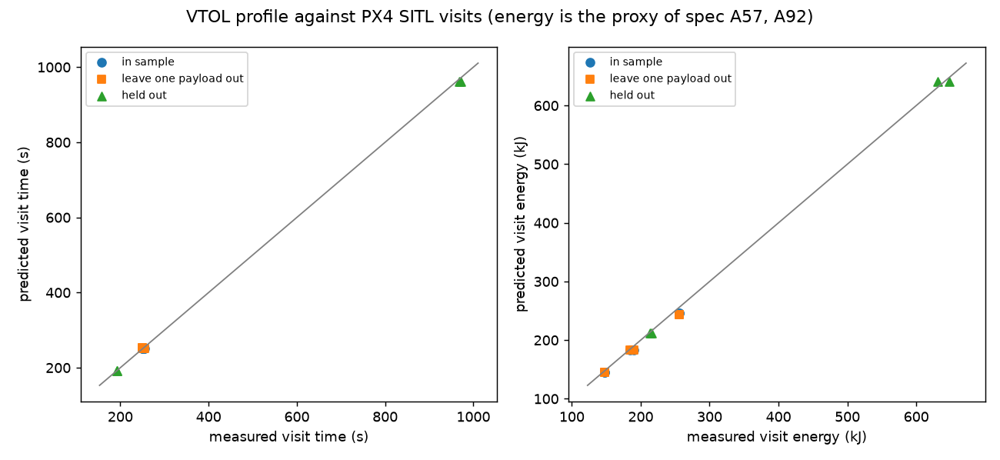
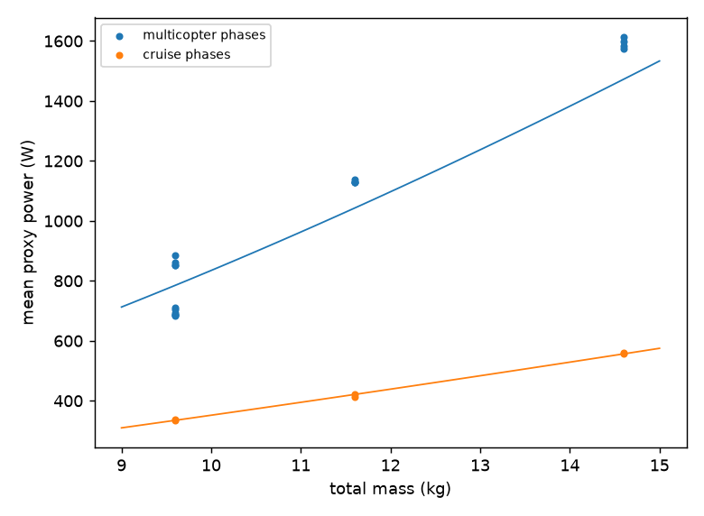

# Phase 7: VTOL airframe

The multirotor fitted in Phase 5 reaches 5.7 km with a 5 kg pod on the coupled 900 Wh battery,
so the parts-logistics scenario lost its Mon Valley factories. This phase flies a VTOL in PX4
SITL, fits a flight profile to it, and wires that profile into the sim. Every number is a
placeholder (spec A01) unless it comes from a cited source; SITL has no power model, so all
energies are a proxy (A57, A92).

## 1. Airframe audit

PX4 v1.17.0 ships a Gazebo standard VTOL (`Tools/simulation/gz/models/standard_vtol`, airframe
4004): a flying wing with four lift rotors on booms and a pusher. Read from its model and
airframe files:

| Item | Stock standard VTOL | Scaled for this phase |
|---|---|---|
| Mass | 5.025 kg (body 5, five rotors 0.005 each); no MTOW given | 9.0 kg empty + 0.6 kg latch + pod; design MTOW 16 kg (the scenario's) |
| Wing area | 2 x 0.50 m2 (lift-drag surfaces), elevator 0.01 m2 | 2 x 1.59 m2, elevator 0.032 m2 |
| Lift slope, stall angle | 4.75 /rad, 0.339 rad: CL max 1.61 | unchanged |
| Stall speed | 7.1 m/s at 5.0 kg | 6.8 m/s at 14.6 kg (5 kg pod) |
| Cruise (FW_AIRSPD_TRIM) | 15 m/s | 15 m/s, 2.2 times stall |
| Hover thrust (4 rotors, 1500 rad/s) | 180 N: thrust/weight 3.65 | 573 N: 4.0 at 14.6 kg |
| Pusher thrust (3500 rad/s) | 105 N | 333 N |

The Phase 5 multirotor was PX4's x500 scaled to 9 kg empty and 16 kg MTOW with thrust/weight
2.0 at MTOW.

Scaling (spec A91), the simplest that keeps PX4's 4004 gains valid: one factor s = 16 / 5.025
= 3.18 on body mass and inertia, every motor and rotor-drag constant, and the lift-drag
surface areas. At 16 kg the scaled vehicle then has the stock model's accelerations, stall
speed and thrust/weight; at 14.6 kg it has slightly more margin. Geometry stays the stock
model's, plus two skids under the motor booms. The stock model rests on its wing; the skids
give the carried pod 1 cm of ground clearance. The latch, the down camera (0.25 m forward,
0.15 m below the body) and the pod joints are added as on the x500. `px4/tools/make_vehicle.py
--airframe vtol` writes it from PX4's tree, which is not changed.

`px4/tools/vtol_smoke.sh` flies it with PX4's own commander, with the 5.6 kg of latch and pod
fixed to the body. At the stock 10 m take-off height the transition sank 8 m during the speed
build-up, and the vehicle hit the ground at 17 m/s. At the lane's 61 m it:

- climbs as a multirotor and transitions with a 2.5 m dip;
- loiters as a fixed wing at 61 +- 0.8 m and 15.0 m/s airspeed;
- transitions back and lands.

No tuning was needed beyond the airspeed parameters in `px4/params/sitl_vtol.params`.

## 2. Delivery visit

`px4/run_flight.sh --airframe vtol` flies the Phase 4 visit with the same pad, fleet manager,
detector and logger nodes, the same spec messages and logs. Only the lane changes. After the
multirotor climb (D02) the drone commands a transition to fixed wing and streams an offboard
path setpoint (the destination's holding fix with the track velocity), so PX4's fixed-wing
controller follows the lane line. 150 m before the fix (placeholder:
`px4/config/flight.yaml` `vtol.back_transition_m`) it commands the transition back, and it
covers the rest as a multirotor (D03). Approach, precision landing, release, hop and latch are
the Phase 4 multirotor ones. The runner refuses to start under 20 GB free and stops a visit,
Gazebo, PX4 and nodes included, after three times its expected wall time.

The logger records the VTOL phase changes (MC, TRANSITION_FW, FW, TRANSITION_MC) as events, and
the pusher command in the sample record (spec 9.5 version_minor 1, in the former reserved
bytes).

| Run (5 kg, seed 1) | Lane | Wall | Climb | To FW | FW cruise | Back to MC | MC to fix | Approach + landing IN | Landing error IN / OUT | Peak RSS | Validator |
|---|---|---|---|---|---|---|---|---|---|---|---|
| 1x | 3, hub to VA Pittsburgh, 2093 m | 273 s | 26.6 s | 8.2 s | 125.2 s | 6.3 s | 12.9 s | 49.7 s | 8.5 / 4.7 cm | 693 MB | pass |
| 2x | 4, hub to Edgar Thomson, 12 896 m | 499 s | 27.2 s | 8.2 s | 842.7 s | 6.5 s | 12.7 s | 45.2 s | 7.6 / 5.3 cm | 706 MB | pass |

The energy proxy over lane 3 (D02 to D03, transitions included) is 117 kJ, against 314 kJ for
the multirotor flown the same day. The multirotor still completes its fit-lane visit after
the node changes and passes the validator, and so does the committed Phase 4 sample log.

## 3. Calibration flights

`px4/tools/run_batch.sh vtol_cal vtol_0_1 vtol_0_2 vtol_2_1 vtol_2_2 vtol_5_1 vtol_5_2
vtol1x_5_1` flies the fit lane (3, 2093 m) with 0, 2 and 5 kg, two seeds each at 2x real time,
and 5 kg once at 1x. All seven completed, pass the validator, peak at 688 MB RSS and carry one
px4/ revision (`2549e822e0ac`, recorded in each run.json). A first batch mixed two runner
versions after an edit during the batch: one changed only run.json metadata, not the flight. It
was discarded and the whole batch re-flown. `pipeline/calib/vtol_phases.py` refuses a batch with
mixed or uncommitted versions.

That script reduces the logs to `pipeline/calib/vtol_phases.json` (committed; the raw logs are
not), one row per run and phase. Distances are along the line from the start to the holding
fix on the ground-truth track. Energy is the proxy (A57, A92). Mean of the two 2x runs per
payload:

| Phase | 0 kg: s, m/s, m along, kJ | 2 kg | 5 kg |
|---|---|---|---|
| MC takeoff and climb | 25.9, 0.0, 0, 22.6 | 26.2, 0.0, 0, 29.6 | 26.5, 0.0, 0, 41.9 |
| Transition to FW | 5.6, 5.9, 33, 6.5 | 6.7, 6.0, 40, 8.9 | 8.4, 6.2, 49, 13.8 |
| FW cruise | 125.5, 15.2, 1909, 42.2 | 125.8, 15.1, 1901, 52.5 | 125.0, 15.2, 1893, 69.8 |
| Back-transition and MC to the fix | 19.2, 7.8, 149, 17.6 | 19.3, 7.8, 149, 22.2 | 20.4, 7.4, 148, 33.1 |
| Approach and landing on IN | 50.0, 0.1, -2, 42.5 | 49.2, 0.2, -2, 55.8 | 50.5, 0.1, -2, 81.1 |
| Hop IN to OUT (empty) | 23.7, 0.4, 4, 16.4 | 25.4, 0.4, 4, 18.0 | 23.4, 0.4, 4, 16.0 |

Mean cruise power is 336, 418 and 559 W at 0, 2 and 5 kg; multicopter phases run at about
three times that.

Energy proxy. The four lift rotors use A57's induced power from their commanded speeds. The
pusher uses ideal momentum theory for a propeller in axial flight: thrust T = k w^2, induced
velocity v_i = -V/2 + sqrt(V^2/4 + T/(2 rho A)), power T (V + v_i), with V the speed along the
body x axis (no wind) and the scaled stock disc areas (A92).

Cross-check against the simulator. In steady cruise the pusher thrust should balance the
wing drag of Gazebo's lift-drag model. That drag is 1/2 rho V^2 A cd per surface, with
cd = cda (alpha + a0), alpha from the ground-truth velocity in the body frame and PX4's
attitude. The reference power is drag times speed over the ideal propeller efficiency,
D (V + v_i). Over the middle half of each cruise, the pusher thrust from its commands matches
that drag within the noise of the differentiated track: 14.4 N against 13.9 to 16.5 N at 0 kg,
21.7 N against 20.5 to 23.3 N at 5 kg. The proxy cruise power over the reference is 0.81 to
1.24, mean 1.00 over the seven runs. It is still a proxy: SITL has no power model, and
propeller, motor and ESC losses are left out.

1x against 2x (5 kg, seed 1): the lane (D02 to D03, transitions included) took 152.1 s and
112.3 kJ at 1x, and 151.8 s and 115.0 kJ at 2x (-0.2% and +2.3%). The cruise plateau was
14.99 and 15.46 m/s. The second 2x seed took 155.6 s and 118.4 kJ, so the speed factor's
effect is within the seed-to-seed spread.

`px4/samples/vtol_5_1/` keeps the logs of the first 5 kg run; the others are deleted once
summarized.

## 4. Fit

`pipeline/run.sh calib vtol` runs the VTOL steps; `vtol_fit` fits the profile to the committed
table and `vtol_profile` writes `configs/flight_profiles/px4_sitl_vtol_proxy.toml`. Run twice,
the fit gives byte-identical files: fixed bootstrap seed, sorted inputs. Only the six 2x runs
are fitted; the 1x run is compared, not used. The method is Phase 5's (`docs/calibration.md`):

- constants from the data;
- a time depends on payload only if its regression slope is significant at 5%;
- powers by least squares on relative energy residuals;
- at most three parameters per phase class;
- leave-one-payload-out cross-validation through the core's own model (`sim flight-model`);
- a 2000-draw bootstrap over runs for the uncertainty.

The sim's model of a VTOL visit (spec A93) is takeoff_s + transition_s + L / cruise_speed_mps +
approach_s + hop_s. The multicopter phases use the hover power, the lane uses the cruise power,
and the transition overhead (the transitions and the multicopter stretch to the fix) uses its
own power.

| Class | Parameter | Value | Bootstrap std | Payload dependence (p) |
|---|---|---|---|---|
| Multicopter | hover_power_ref_w | 1472.5 W | 4.2 | power with mass^1.5 |
| | takeoff_s | 26.21 s | 0.12 | none (p = 0.051) |
| | approach_s | 49.88 s | 0.63 | none (0.75) |
| | hop_s | 24.16 s | 0.40 | none (0.63) |
| Cruise | cruise_speed_mps | 15.211 m/s | 0.054 | none (0.73) |
| | cruise_power_ref_w | 556.4 W | 4.5 | |
| | cruise_mass_exponent | 1.212 | 0.028 | significant (p < 1e-6) |
| Transition | transition_s | 14.30 s | 0.69 | none (p = 0.064) |
| | transition_power_ref_w | 2658 W | 95 | power with mass^1.5 |

The reference mass is 14.6 kg, as for the multirotor, and the profile's MTOW is 16 kg. The
fitted VTOL hovers at 1472 W at 14.6 kg against the multirotor's 1831 W, because its scaled
rotor discs are larger (A92). It cruises at 556 W against 2108 W. Cruise power grows with mass
to the 1.21, not the 1.5 of hovering.

Residuals: cruise energy within 1.7% of the model in every run. The single hover power leaves
per-phase residuals as in Phase 5 (A63): takeoff +8%, approach +8%, hop -13%. Fitted takeoff
and transition times grow slightly with payload (p = 0.051 and 0.064), so they stay constants.

| Visit (fit lane) | Time error, in sample | Time error, payload left out | Energy error, in sample | Energy error, payload left out |
|---|---|---|---|---|
| 0 kg, seeds 1 and 2 | +1.0%, +0.9% | +1.5%, +1.3% | -1.9%, -1.8% | -2.3%, -2.2% |
| 2 kg | +0.3%, -0.7% | +0.2%, -0.8% | -0.5%, -3.6% | -0.5%, -3.6% |
| 5 kg | -0.4%, -1.1% | -0.8%, -1.5% | -3.9%, -3.9% | -4.8%, -4.8% |

Leaving a payload out costs at most 1.5% in time and 4.8% in energy. The fit was committed
before the held-out flights were flown.

## 5. Held-out flights

`px4/tools/run_batch.sh vtol_held vtolheld_4_1 vtolheld_4_2 vtolheld_45_1 vtolheld_45_2` flies
5 kg at 2x on two lanes the fit never saw: lane 4, hub to Edgar Thomson (12 896 m, the longest
legal lane under the VTOL profile), and lane 45, Clairton to Old Koppers (1180 m, the shortest
Mon Valley lane); seeds 1 and 2. `pipeline/run.sh calib vtol_heldout` predicts each visit
with `sim flight-model` and the parameters committed before these flights. Nothing is refitted.

| Run | Lane | Visit time, measured / predicted | Error | Visit energy, measured / predicted | Error | Landing error IN / OUT | Wall | Peak RSS |
|---|---|---|---|---|---|---|---|---|
| vtolheld_4_1 | 4, 12 896 m | 971.7 / 962.3 s | -0.97% | 647.4 / 640.7 kJ | -1.02% | 3.2 / 4.6 cm | 479 s | 706 MB |
| vtolheld_4_2 | 4 | 968.7 / 962.3 s | -0.66% | 631.3 / 640.7 kJ | +1.49% | 3.2 / 5.8 cm | 477 s | 713 MB |
| vtolheld_45_1 | 45, 1180 m | 191.9 / 192.1 s | +0.13% | 215.4 / 212.2 kJ | -1.50% | 5.9 / 11.4 cm | 102 s | 694 MB |
| vtolheld_45_2 | 45 | 192.4 / 192.1 s | -0.13% | 214.0 / 212.2 kJ | -0.83% | 5.1 / 4.5 cm | 102 s | 685 MB |

All four complete and pass the validator; the targets (time 5%, energy 15%, placeholders) hold
with a wide margin. Per phase the errors are larger and partly cancel, as in the fit: takeoff
energy is 9 to 11% over the model, approach -0.2 to +11%, hop 4 to 15% under (A63's single hover
power). On the long lane the model's lane time is 1.0% short: the cruise on lane 4 is slightly
slower than on the fit lane.

SITL's simulated battery never went below 50% (PX4's `SIM_BAT_MIN_PCT` floor), so no failsafe
tripped and the SITL battery was not raised. The flights ran the calibration batch's flight
code: three commits outside px4/ landed while the batch flew, so run.json carries three
revisions, and `vtol_heldout` checks that px4/ (the sample logs aside) is identical at each of
them and at the calibration's `2549e822e0ac`.

## 6. Wind check

`px4/tools/run_batch.sh vtol_wind vtolwind_0_1 ... vtolwind_8_2` flies the fit lane at 5 kg and
2x with a wind from 22 deg, square across the lane (bearing 112 deg) from the left, at 0, 5 and
8 m/s with gusts of 50%, seeds 1 and 2. `pipeline/run.sh calib vtol_wind` writes
`pipeline/calib/out/vtol_wind.json`. It informs the limitations only; nothing is fitted to it.

The wind model (spec A94):

- the wind sits in the Gazebo world, and the wing surfaces (LiftDrag) fly relative to it;
- WindEffects adds a drag of mass x k x (wind - velocity) on the vehicle's links, with
  k = 0.033 /s, a linear fit of a placeholder body drag (CdA 0.1 m2 at 8 m/s);
- the gust is Gaussian noise of 50% of the wind on the magnitude, drawn every physics step;
- the calm level flies with the same systems on, at 0 m/s.

| Wind | Visits completed | Landing error IN (cm) | Landing error OUT (cm) | Crab in cruise | Ground speed in cruise | Tilt on approach |
|---|---|---|---|---|---|---|
| 0 m/s | 2 of 2 | 12.0, 7.4 | 6.5, 7.5 | +10.9, -3.1 deg | 15.25, 15.01 m/s | 0.5, 0.5 deg |
| 5 m/s | 1 of 2 | 5.7, 2.7 | 25.9, 14.3 | -18.4, -16.5 deg | 15.78, 15.63 m/s | 1.8, 1.6 deg |
| 8 m/s | 0 of 2 | 29.0, 27.5 | 42.3, 39.1 | -25.4, -21.8 deg | 16.60, 15.95 m/s | 1.8, 2.0 deg |

All 12 landings happened. The three failed visits stopped at the latch: the drone landed on
OUT more than the 15 cm capture radius (A71) from the waiting pod, and the pad could not verify
the lock (V29/V30). Each run's outcome is in the JSON; all six ran px4/ revision `3ad599cedf98`.

The vehicle feels the wind:

- in cruise it crabs into it, 17 to 18 deg at 5 m/s and 22 to 25 deg at 8 m/s (the calm runs
  show -3 to +11 deg, the measure's noise and sideslip);
- on approach it leans 1.6 to 2.0 deg into it, against 0.5 deg in calm;
- the landing error on OUT grows from 7 cm in calm to 14 to 26 cm at 5 m/s and 39 to 42 cm at
  8 m/s.

What this check does not show (limitations):

- Gazebo's airspeed sensor ignores the wind, so PX4's airspeed is ground speed along the body
  axis. PX4 held that at about 15 m/s, so ground speed along the track rose with the crab angle,
  and the true airspeed was higher than PX4 thought. A headwind would have the opposite, unsafe
  sign. The sim's weather model (2.10) assumes a correct airspeed.
- The rotors (MulticopterMotorModel) do not see the wind, only the wing surfaces and the body
  drag do; the body drag coefficient is a placeholder.
- The gust is white noise at the physics rate, which the vehicle's inertia averages out. It is
  not a gust spectrum, and the effects above come from the steady wind.
- Landing on OUT in a crosswind is the weak point. The sim's derived latch fault widens the OUT
  error with gusts (A80), but nothing in it is calibrated against this check.

Two earlier batches did not produce results. In the first, Gazebo never came up with wind:
the world named a system, so it lost the server config's defaults. In the second, Gazebo's
default drag of 1 /s kept the VTOL below transition airspeed, and every windy run aborted the
transition (PX4 quad-chute). Both were fixed in px4/ and the whole batch re-flown; their
partial logs were deleted. The first batch's calm seed-2 run had failed the same latch check,
with 15.5 cm on OUT.

## 7. The profile in the sim

`pipeline/run.sh calib vtol` writes `configs/flight_profiles/px4_sitl_vtol_proxy.toml`
(`source = "px4-sitl-proxy"`, every value `assumption = true`) from the fitted parameters. The
VTOL keys (spec 8.7, A93) are optional, so every earlier profile and scenario loads and runs as
before:

- `airframe = "VTOL"` and its own `mtow_kg` (16 kg); R20 (cruise power at least the rotors'
  induced power under weather) applies to multirotors only;
- `transition_s` and `transition_power_ref_w`, charged once per flight, with the first lane from
  a pad or a hold; the energy guards add one transition to the dispatch need and one to a
  diversion;
- `cruise_mass_exponent` (1.21) in place of the multirotor's 1.5.

Battery-mass coupling is A68's: 4.5 kg airframe (placeholder), 200 Wh/kg. Under weather, a VTOL's
cruise power is proportional to airspeed: the SITL wing's level-flight drag does not change
with speed, so thrust power is drag times airspeed (A93).

## 8. Battery, range and network

`pipeline/run.sh calib vtol` (step `vtol_consequences`) sizes the battery with the core's own
energy guard (`sim battery`). The target is hub to Edgar Thomson, 12 896 m, the longest legal
lane of Phase 3's catalog, at 5 kg with the battery's mass coupled to it. The fixed point is
619.4 Wh after 14 iterations, rounded to 620 Wh (2.232 MJ). Empty mass is 7.6 kg, so 5 kg plus
the 0.6 kg latch stays under the 16 kg MTOW.

Longest one-way lane `dispatch_ok` accepts (no diversion leg, an upper bound):

| Payload | VTOL, 620 Wh coupled | Multirotor, 900 Wh coupled (Phase 6b) |
|---|---|---|
| 2 kg | 36.3 km | 12.8 km |
| 5 kg | 14.7 km | 5.7 km |

The pipeline builds `parts_logistics_pittsburgh_vtol` (params.yaml) with the VTOL profile and
that battery. Against the 900 Wh multirotor network it has:

- 9 pads instead of 5: Edgar Thomson, Josh Steel, Clairton and Old Koppers are gained, none
  lost;
- 24 lanes instead of 10: 14 gained, none lost;
- 10 flows, Edgar Thomson and Josh Steel from both warehouses among them.

Clairton is in the network, with lanes, but gets no flow. Its route from either warehouse runs
through Edgar Thomson and needs 1.99 to 2.00 MJ. The usable energy is (0.95 - 0.20) x 2.232 =
1.67 MJ. Old Koppers is left out for the same reason. Serving them would take a bigger
battery, a relay pad or battery swap, none of which this phase adds.

## 9. Scenarios

`uv run analysis/sweep.py --base vtol` runs the Phase 6a layout sweep on the VTOL scenario:

- charger power 1.5, 3, 6 and 12 kW;
- parking 0 to 2;
- OUT spots 1 to 4 (OUT_4 is new in schema 1.9.0);
- seeds 1 to 5.

It uses the same cost proxy (per pad: 100 + 20 per spot + 10 per charger kW + 15 per parking
slot) and the same rule: the cheapest layout within 10% of the best mean door-to-door. The best
is 689 s; the chosen layout is 1.5 kW, no parking and 4 OUT spots at 2340 cu, 738 +- 18 s, with
no request rejected. `configs/parts_logistics_pittsburgh_vtol_layout` is that scenario.

`uv run analysis/fleet.py --base vtol` sweeps fleet size and pods per warehouse at that layout:

| Criterion | Fleet | Pods per warehouse | Door-to-door (s) | Rejected |
|---|---|---|---|---|
| Smallest with under 5% rejected | 4 | 2 | 5648 +- 1134 | 0.7% |
| ... and faster than the truck (2271 s) | 6 | 4 | 864 +- 52 | 0.0% |
| ... and within 10% of the best (704 s) | 8 | 6 | 726 +- 20 | 0.0% |

`configs/parts_logistics_pittsburgh_vtol_demo` is the layout scenario (fleet 7 as built by the
pipeline) with every realism key on:

- repair, yield on request, derived latch fault, marker self-check and reorder window (6a);
- the hourly AGC weather with the per-route energy guard, under TRUCK_FALLBACK (Part A showed
  that WAIT fills the backlog cap in bad weeks);
- traffic in local time (`traffic.start_unix_s`);
- order outcomes.

For weather, the four lift rotors' disc area is 0.40 m2 and the airspeed limit is
`FW_AIRSPD_MAX` (22 m/s). The other weather limits stay the 6b demo's placeholders.

## 10. Results

`uv run analysis/vtol_year.py` (about 10 s) runs both demos over all 156 complete weeks of the
weather series, seeds 1 and 2, under both hold policies, with order outcomes on. The
multirotor run is the 6b demo with only `metrics.order_outcomes` added; the VTOL run is
`parts_logistics_pittsburgh_vtol_demo`. Both ratios are network door-to-door over the truck
baseline, order-weighted per week. The lower bound also counts every unfinished order at its
time to the end of the run. Values are medians over weeks (p10 to p90). Full tables are in
`analysis/out/vtol_year.md`; two runs give byte-identical output.

| Demo | Policy | Ratio, delivered | Ratio, lower bound | Completion |
|---|---|---|---|---|
| Multirotor, 6b as published | WAIT | 0.56 (0.26 to 6.61) | - | 97.8% (61.1% to 98.5%) completed share |
| Multirotor, rerun completion-aware | WAIT | 0.59 (0.27 to 7.15) | 0.61 (0.27 to 8.02) | 97.7% (60.7% to 98.5%) |
| VTOL | WAIT | 5.16 (1.48 to 16.89) | 6.27 (1.57 to 37.43) | 63.1% (14.4% to 94.0%) |
| Multirotor, 6b as published | TRUCK_FALLBACK | 0.41 (0.26 to 6.31) | - | 98.2% (68.4% to 98.6%) completed share |
| Multirotor, rerun completion-aware | TRUCK_FALLBACK | 0.42 (0.27 to 6.19) | 0.43 (0.27 to 6.56) | 98.1% (67.9% to 98.6%) |
| VTOL (the demo's policy) | TRUCK_FALLBACK | 0.98 (0.63 to 1.36) | 0.98 (0.62 to 1.36) | 98.5% (98.1% to 98.8%) |

The 6b-published and rerun columns differ slightly because the rerun pools two seeds per week
(order-weighted) where 6b averaged three seeds' ratios. Flyable hours are the same for both
demos: 96.4% median (85.7% to 100%).

Outcome breakdown over the year (share of all requests):

| Demo | Policy | Drone | Truck | Rejected at cap | Blocked, weather | Blocked, energy | Waiting | Diverted or failed |
|---|---|---|---|---|---|---|---|---|
| Multirotor | WAIT | 87.2% | 0.0% | 10.7% | 0.2% | 0.2% | 0.1% | 1.5% |
| Multirotor | TRUCK_FALLBACK | 85.7% | 4.9% | 7.4% | 0.0% | 0.2% | 0.1% | 1.4% |
| VTOL | WAIT | 57.6% | 0.0% | 37.1% | 0.2% | 1.5% | 0.2% | 3.4% |
| VTOL | TRUCK_FALLBACK | 71.8% | 26.7% | 0.0% | 0.0% | 0.2% | 0.0% | 1.2% |

The VTOL network reaches Mon Valley but is slower overall. Under TRUCK_FALLBACK its median ratio
is 0.98 against the multirotor's 0.42, though its spread is far narrower: it never has a week
like the multirotor's p90 of 6.19. Under WAIT it is worse than the multirotor in most weeks.

Why: 90% of the VTOL's trucked orders (100 274 of 111 696) are on the four flows to Edgar
Thomson and Josh Steel. The battery was sized for the longest lane in still air at 20 C with no
margin (section 8). Any headwind (cruise power rises with airspeed, A93) or cold (the derate
below 20 C, A81) blocks those routes for the hour (A89), and their orders wait for the
fallback timeout and go by truck. Turning the cold derate off in the three named weeks cuts the
trucked orders by 25 to 29%, so cold is part of it and wind the larger part. That diagnostic
was a one-off check and is not in the committed outputs.

Mon Valley flows of the VTOL demo over the year, TRUCK_FALLBACK:

| Flow | Drone orders | Drone door-to-door | Truck baseline | Ratio | Trucked orders | Trucked door-to-door |
|---|---|---|---|---|---|---|
| Hub to Edgar Thomson | 11 157 | 1640 s | 2912 s | 0.56 | 31 661 | 6548 s |
| Hub to Josh Steel | 19 065 | 1403 s | 2719 s | 0.52 | 21 329 | 6385 s |
| Achieva to Edgar Thomson | 11 548 | 1575 s | 2869 s | 0.55 | 27 937 | 6534 s |
| Achieva to Josh Steel | 19 532 | 1365 s | 2688 s | 0.51 | 19 347 | 6373 s |

When the drone flies these flows it takes about half the truck's time; most of their orders do
not fly. Under WAIT the same flows average 5 to 13 times the truck. The multirotor network has no
Mon Valley pads, so these flows go by truck there.

Named weeks (TRUCK_FALLBACK; the WAIT rows are in `analysis/out/vtol_year.md`). The split covers
drone-delivered orders, in seconds, next to their truck baseline:

| Week | Demo | Drone / trucked | Completion | Pod wait | Queue | Pad service | Flight | Door-to-door | Truck | Ratio, delivered |
|---|---|---|---|---|---|---|---|---|---|---|
| 2023-10-23, median wind | Multirotor | 2468 / 189 | 97.4% | 118 | 172 | 147 | 152 | 589 | 1919 | 0.49 |
| | VTOL | 1847 / 781 | 98.1% | 158 | 150 | 145 | 286 | 739 | 2094 | 1.06 |
| 2024-01-08, windiest | Multirotor | 691 / 748 | 52.7% | 10345 | 2649 | 232 | 152 | 13379 | 1951 | 13.20 |
| | VTOL | 1359 / 1270 | 98.1% | 155 | 345 | 168 | 184 | 853 | 1957 | 1.54 |
| 2025-01-20, coldest | Multirotor | 519 / 1404 | 70.5% | 6629 | 1324 | 203 | 148 | 8304 | 1880 | 6.83 |
| | VTOL | 753 / 1906 | 99.3% | 125 | 78 | 129 | 169 | 501 | 1915 | 1.97 |

The 6b demo has no energy route guard; the VTOL demo does. That explains most of why the VTOL
completes 98 to 99% of the windiest and coldest weeks where the multirotor completes 53 to 71%:
with the guard and TRUCK_FALLBACK, the multirotor demo also completes 98 to 99% of those weeks
(Part A, analysis/out/completion.md).

## 11. Known limitations

- All energies are SITL proxies (A57, A92); SITL has no power model.
- The VTOL battery has no margin for wind or cold on its longest routes (section 10). Sizing it
  for a cold, windy hour would serve Mon Valley more often; that is not done here.
- Clairton and Old Koppers are in the network but get no flows (section 8).
- The wind check found PX4's SITL airspeed ground-referenced and the OUT landing the weak point
  in a crosswind (section 6). Nothing in the sim is calibrated from it.
- The scaled airframe keeps the stock model's geometry and gains (A91). It is not a real
  product.

## 12. Assumptions

Choices made where the brief left an option open, the simplest each time. Model assumptions
are in the spec (A88 to A94).

- Airframe: PX4's standard VTOL scaled by one factor on mass, inertia, motor constants and
  surfaces (A91). Airspeeds stall 7, min 10, trim 15, max 22 m/s (`px4/params/sitl_vtol.params`).
- Back-transition 150 m before the holding fix; the transition is charged once per flight (A93).
- Calibration at 2x real time; the 1x run is a check, not fitted.
- Battery: A68's coupling (4.5 kg airframe, 200 Wh/kg), sized for the longest legal lane at
  5 kg in still air at 20 C, with no margin for wind or cold.
- Held-out lanes: lane 4 (hub to Edgar Thomson, the longest legal under the VTOL profile) and
  lane 45 (Clairton to Old Koppers, the shortest with a Mon Valley pad).
- Wind check: the fit lane, wind from 22 deg (square across it), body drag CdA 0.1 m2, gusts
  as Gazebo's per-step noise; the calm level flies with the same systems on.
- VTOL demo: TRUCK_FALLBACK with the energy route guard; the lift rotors' disc area (0.40 m2)
  and FW_AIRSPD_MAX (22 m/s) for the weather keys; every other weather and traffic value as in
  the 6b demo. Fleet 7 as the pipeline sized it, not the fleet sweep's 8.
- Mon Valley flows: flows to or from a pad the VTOL network has and the multirotor's lacks.
- Layout sweep: OUT spots up to 4, which needs schema 1.9.0.
- Commits outside px4/ while a batch flew do not change its flight code; `vtol_heldout` checks
  this against git.
